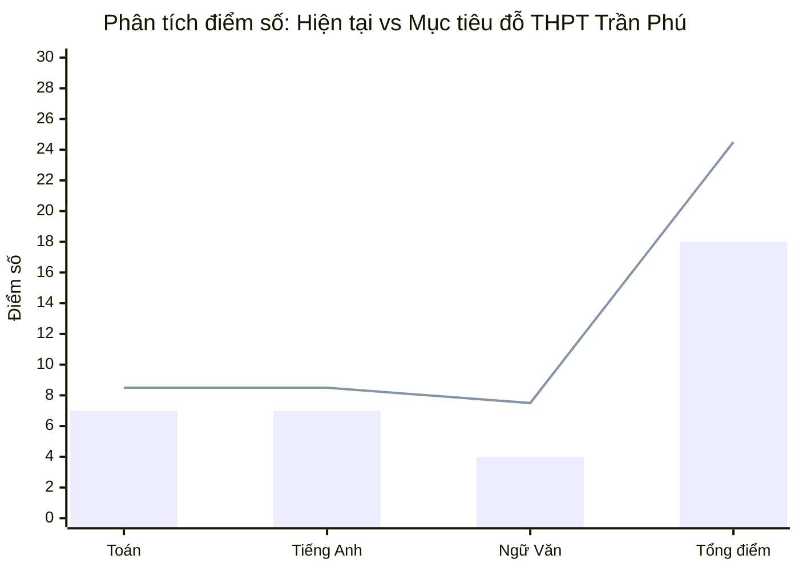
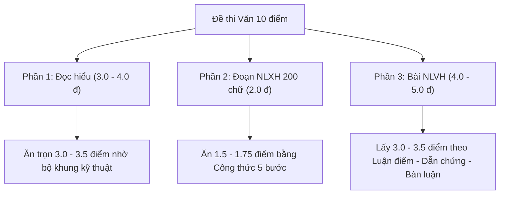

# CHIẾN LƯỢC TÁC CHIẾN THI ĐỖ THPT TRẦN PHÚ (VĨNH YÊN)
### DÀNH RIÊNG CHO CON TRAI LỚP 9: TOÁN 7 - ANH 7 - VĂN 4

---

## 1. PHÂN TÍCH THỰC TRẠNG & BÀI TOÁN ĐIỂM SỐ

### Điểm chuẩn & Đặc thù tuyển sinh THPT Trần Phú (Vĩnh Yên - Vĩnh Phúc)
- **Vị thế:** Trường THPT công lập không chuyên top 1 của TP. Vĩnh Yên, tỉnh Vĩnh Phúc. Tỉ lệ chọi và điểm chuẩn luôn thuộc nhóm cao nhất tỉnh (Điểm chuẩn thường dao động từ **22.5 đến trên 24 điểm**).
- **Cấu trúc đề thi Sở GD&ĐT Vĩnh Phúc:**
  - **Môn Toán (120 phút):** Kết hợp trắc nghiệm khách quan (chiếm khoảng 20%) và tự luận (80%). Có độ phân hóa cao ở toán thực tế, Vi-ét và hình học.
  - **Môn Ngữ văn (120 phút):** 100% tự luận. Ngữ liệu Đọc hiểu ngoài SGK, Đoạn văn Nghị luận xã hội (khoảng 200 chữ) và Bài văn Nghị luận văn học.
  - **Môn Tiếng Anh (60 phút):** Trắc nghiệm khách quan đánh giá ngữ âm, ngữ pháp - từ vựng, chức năng giao tiếp, đọc hiểu và nhận diện lỗi sai / viết lại câu.

### Đánh giá năng lực thực tế của con qua điểm khảo sát

1. **Toán (7.0) & Tiếng Anh (7.0) - Tố chất rất tốt:**
   - Con hoàn toàn **không bị mất gốc**! Với điểm 7 khảo sát đầu năm lớp 9, con có tư duy logic rất khá, nắm được 70% kiến thức nền tảng.
   - Vấn đề của con là: Thiếu tính cẩn thận (sai vặt câu dễ, nhầm dấu, ẩu trắc nghiệm) và chưa có chiến thuật làm các câu vận dụng cao.
   - **Mục tiêu:** Kéo từ $7.0 \rightarrow \mathbf{8.5 - 9.0}$.
2. **Ngữ văn (4.0) - "Tử huyệt" nhưng cũng là "Mỏ điểm" dễ khai thác nhất:**
   - Điểm 4 cho thấy con đang **sợ viết, lười đọc, không biết cách lập luận và trình bày theo barem**. Con trai thường xem Văn là môn "trừu tượng, cảm tính" nên chán nản.
   - Khi cộng lại: $7 + 7 + 4 = 18$ điểm $\rightarrow$ **Chắc chắn trượt Trần Phú nếu không thay đổi**.
   - Tuy nhiên, môn Văn thi vào 10 chấm theo **Ý và BAREM ĐIỂM của Sở**, không chấm theo độ dài lê thê hay câu từ bay bổng. Dạy con viết Văn bằng **"Công thức logic như giải Toán"** sẽ giúp con bật ngay lên mức **$7.0 - 7.5$** chỉ trong 2-3 tháng.
   - **Kịch bản điểm trúng tuyển:** $\text{Toán } 8.5 + \text{Anh } 8.5 + \text{Văn } 7.5 = \mathbf{24.5 \text{ điểm}} \rightarrow$ **Đỗ đàng hoàng vào top trường Trần Phú!**

---

## 2. CHIẾN DỊCH "CẤP CỨU MÔN VĂN": TỪ 4 LÊN 7.5 DÀNH CHO CON TRAI

> [!IMPORTANT]
> **Tâm lý con trai lười học Văn:** Con sợ phải viết 3 - 4 trang giấy, sợ "văn mẫu bay bổng". Bố mẹ và gia sư/thầy cô cần thay đổi tư duy: **Dạy Văn bằng Công thức Toán học và Tư duy logic**.

### Chiến thuật lấy điểm từng phần trong đề thi Văn:

#### Phần 1: Đọc - Hiểu văn bản (Chiếm 3.0 - 4.0 điểm) $\rightarrow$ Mục tiêu: Ăn trọn vẹn điểm!
- Con trai rất thích phần này vì nó ngắn, giống như trắc nghiệm có đáp án rõ ràng.
- **Quy tắc trả lời:**
  - Câu hỏi nhận biết (thể loại, phương thức biểu đạt, tác giả, hoàn cảnh sáng tác, phép tu từ): **Chỉ trả lời trong 1 - 2 dòng**. Không viết rườm rà.
  - Câu hỏi nêu tác dụng của biện pháp tu từ: Áp dụng công thức 3 vế:
    $$\text{Tác dụng} = \text{Tăng sức gợi hình/gợi cảm} + \text{Làm nổi bật hình ảnh/nội dung X} + \text{Bộc lộ tình cảm/thái độ của tác giả Y}$$
  - Câu hỏi thông điệp/rút ra bài học: Nêu rõ 2 thông điệp, mỗi thông điệp viết thành 1 gạch đầu dòng rõ ràng, mạch lạc.

#### Phần 2: Đoạn văn Nghị luận xã hội khoảng 200 chữ (Chiếm 2.0 điểm) $\rightarrow$ Mục tiêu: 1.5 - 1.75 điểm
Áp dụng chuẩn **Công thức 5 bước - Không cần bay bổng, chỉ cần gãy gọn, đủ ý:**
1. **Mở đoạn (1 - 2 câu):** Trả lời thẳng vào vấn đề: *"Trong hành trình trưởng thành, [Vấn đề X: lòng kiên trì / tính tự lập / sự trung thực...] chính là chìa khóa quan trọng dẫn tới thành công."*
2. **Giải thích (1 - 2 câu):** [Vấn đề X] là gì? (Ví dụ: Kiên trì là nỗ lực không ngừng nghỉ vượt qua khó khăn, không bỏ cuộc giữa chừng).
3. **Bàn luận & Phân tích (4 - 5 câu):** 
   - Vì sao phải có X? Người có X sẽ nhận được gì? (Tạo dựng uy tín, vượt qua giới hạn bản thân, được mọi người tin yêu).
   - Xã hội ra sao nếu ai cũng có X?
4. **Dẫn chứng thực tế (2 - 3 câu):** Chọn 1 tấm gương cụ thể, quen thuộc (Nick Vujicic, Thầy giáo Nguyễn Ngọc Ký, Đội tuyển bóng đá, câu chuyện cứu trợ bão lũ... tránh nêu chung chung).
5. **Phản đề & Bài học (2 - 3 câu):** Phê phán người lười biếng, ỷ lại $\rightarrow$ Bản thân con là học sinh lớp 9 cần rèn luyện tính kiên trì ngay từ việc tự giác học tập mỗi ngày.

#### Phần 3: Bài văn Nghị luận văn học (Chiếm 4.0 - 5.0 điểm) $\rightarrow$ Mục tiêu: 3.0 - 3.5 điểm
- **Không học thuộc lòng cả bài văn mẫu dài:** Não con trai sẽ từ chối tiếp thu.
- **Học theo SƠ ĐỒ CÂY LUẬN ĐIỂM (Bullet points):**
  - Mỗi tác phẩm chỉ cần nắm: 1 Hoàn cảnh sáng tác, 2 - 3 Luận điểm lớn, mỗi luận điểm kèm theo 2 dẫn chứng then chốt (câu thơ hoặc hành động của nhân vật).
  - Cấu trúc 1 đoạn thân bài chuẩn: **Câu chủ đề nêu luận điểm $\rightarrow$ Trích dẫn chứng $\rightarrow$ Phân tích từ ngữ/hình ảnh nghệ thuật $\rightarrow$ Nhận xét cảm xúc của nhân vật/tác giả.**

---

## 3. CHIẾN THUẬT NÂNG TẦM TOÁN & TIẾNG ANH (TỪ 7.0 LÊN 8.5+)

### MÔN TOÁN: Khắc phục lỗi ẩu & Chinh phục câu phân loại

1. **Khóa chặt phần Trắc nghiệm (2.0 điểm - Sở Vĩnh Phúc):**
   - Học sinh điểm 7 thường chủ quan phần trắc nghiệm, làm nhanh để sang tự luận dẫn đến mất $0.4 - 0.8$ điểm oan uổng (do nhầm điều kiện $\sqrt{A}$ có nghĩa khi $A \ge 0$, quên điều kiện mẫu khác 0, nhầm dấu âm).
   - *Hành động:* Luyện bấm máy tính Casio để kiểm tra lại nghiệm; rèn thói quen gạch chân từ khóa trong đề trắc nghiệm.
2. **Làm chủ Tự luận cơ bản (6.0 điểm):**
   - Rút gọn biểu thức + câu hỏi phụ: Phải đạt điểm tuyệt đối $1.5/1.5$.
   - Giải bài toán bằng cách lập PT/HPT: Làm thành thạo 3 dạng chủ đạo (Toán chuyển động, Toán năng suất, Toán kinh tế/phần trăm).
   - Hệ thức Vi-ét: Nắm chắc dạng tham số $m$ có điều kiện nghiệm đối xứng ($x_1^2 + x_2^2$, $x_1 - x_2$).
3. **Tấn công Hình học (3.0 điểm):**
   - Câu a (Chứng minh tứ giác nội tiếp): Phải ăn trọn $1.0$ điểm.
   - Câu b (Chứng minh hệ thức tam giác đồng dạng / tiếp tuyến): Luyện kỹ các mô hình hình học quen thuộc (tam giác nhọn nội tiếp đường tròn, hai đường cao cắt nhau tại trực tâm).
   - Câu c (Cực trị/điểm cố định): Nếu con đuối, có thể bỏ qua để dồn thời gian soát lại toàn bộ bài làm trước đó. Đạt $8.5 - 9.0$ Toán không nhất thiết phải làm được câu cuối cùng!

### MÔN TIẾNG ANH: Tối ưu hóa 50 câu trắc nghiệm

1. **Không để rơi điểm ở Ngữ âm & Ngữ pháp nhận biết (30 câu đầu):**
   - Thuộc làu quy tắc phát âm đuôi `-s/es`, `-ed` và trọng âm 2 âm tiết.
   - Khóa chặt các chuyên đề ngữ pháp chắc chắn có trong đề Vĩnh Phúc: Thì quá khứ đơn vs Hiện tại hoàn thành, Câu bị động, Câu điều kiện loại 1 & 2, Mệnh đề quan hệ, Cấu trúc câu gián tiếp.
2. **Nâng cao vốn từ & Đọc hiểu (20 câu sau):**
   - Học từ vựng theo cụm (Collocations) thay vì học từ đơn lẻ (Ví dụ: học *make an effort, pay attention to, take part in*).
   - Luyện kỹ năng làm bài Đọc hiểu: Đọc câu hỏi trước $\rightarrow$ Gạch chân từ khóa $\rightarrow$ Quét lên đoạn văn để tìm thông tin (Scanning).

---

## 4. THỜI KHÓA BIỂU ĐIỀU CHỈNH ĐẶC BIỆT (DỒN LỰC CHO MÔN VĂN)

Để vực dậy môn Văn từ 4 lên 7 trong khi vẫn duy trì và nâng cao Toán - Anh, cần bố trí thời gian biểu có sự ưu tiên rõ ràng:

### Chi tiết các buổi tối (19h45 - 22h15)

| Thứ | Ca 1 (19h45 - 20h40) | Ca 2 (20h55 - 21h45) | Ca chốt (21h50 - 22h15) |
| :--- | :--- | :--- | :--- |
| **Thứ 2** | **VĂN (Cứu nguy):** Luyện 1 đề Đọc - Hiểu theo chuẩn cấu trúc Vĩnh Phúc | **TOÁN:** Rút gọn biểu thức + Câu hỏi phụ chứa tham số | Ôn 10 từ vựng Tiếng Anh |
| **Thứ 3** | **TIẾNG ANH:** Luyện 30 câu trắc nghiệm ngữ âm, từ vựng, ngữ pháp | **TOÁN:** Giải toán bằng cách lập PT/HPT (Toán thực tế) | Đọc 1 bài đọc hiểu Văn ngắn |
| **Thứ 4** | **VĂN (Cứu nguy):** Viết 1 đoạn văn Nghị luận xã hội theo công thức 5 bước | **TIẾNG ANH:** Luyện chuyên đề Viết lại câu & Mệnh đề quan hệ | Xem lại lỗi sai môn Toán |
| **Thứ 5** | **TOÁN (Hình học):** Tứ giác nội tiếp & Hệ thức lượng | **VĂN (Cứu nguy):** Lập dàn ý phân tích 1 nhân vật/đoạn trích (theo sơ đồ ý) | Ôn 10 cụm từ Phrasal verbs |
| **Thứ 6** | **TIẾNG ANH:** Luyện bài đọc hiểu điền từ & đọc hiểu trả lời câu hỏi | **TOÁN:** Luyện bài toán đồ thị hàm số & Hệ phương trình | Bố mẹ cùng con kiểm tra Sổ lỗi sai tuần |

### Ngày Thứ Bảy & Chủ Nhật (Tăng tốc & Phục hồi)

- **Chiều Thứ Bảy (14h30 - 17h00):**
  - **14h30 - 15h30:** Làm trọn vẹn 1 đề Tiếng Anh Vĩnh Phúc (60 phút). Chấm và chữa ngay.
  - **15h45 - 17h00:** Giải 5 bài Toán hình học hay gặp trong đề thi Vĩnh Phúc.
  - **17h00 - 19h00:** **BẮT BUỘC RA NGOÀI VẬN ĐỘNG / THỂ THAO** (Đá bóng, cầu lông, đạp xe) để con xả stress và tái tạo năng lượng não bộ.
- **Sáng Chủ Nhật (08h00 - 10h15):**
  - **08h00 - 10h00 (120 phút):** **THỰC CHIẾN ĐỀ TOÁN VĨNH PHÚC** (Bấm giờ làm trắc nghiệm + tự luận nghiêm túc).
  - **10h00 - 10h15:** Tự đối chiếu đáp án, ghi điểm vào nhật ký.
- **Chiều Chủ Nhật (14h30 - 16h45):**
  - **14h30 - 16h30 (120 phút):** **THỰC CHIẾN ĐỀ VĂN VĨNH PHÚC** (Rèn sức bền viết văn trong 120 phút, không bỏ dở).
  - Nhờ giáo viên hoặc người có chuyên môn chấm chữa chỉ ra cụ thể: Đoạn nào viết còn non, câu nào lủng củng.
- **Tối Chủ Nhật:** Thư giãn hoàn toàn sau 21h00, chuẩn bị tinh thần cho tuần mới.

---

## 5. BỘ NGUYÊN TẮC VÀNG CHO BỐ MẸ ĐỒNG HÀNH VỚI CON TRAI

1. **Khích lệ đúng điểm mạnh:** Thường xuyên nhắc con: *"Toán và Anh con đã đạt 7 điểm khảo sát, nghĩa là đầu óc con rất thông minh và sáng dạ. Con chỉ đang bị hổng cách làm bài môn Văn thôi, chỉ cần nắm đúng công thức là môn Văn lên 7.5 rất dễ!"* $\rightarrow$ Lời khen này giúp con xóa bỏ mặc cảm "mình dốt Văn".
2. **Không ép viết dài ngay từ đầu:** Tuần đầu tiên chỉ yêu cầu con viết đoạn văn 15 dòng. Khi con viết được 15 dòng trôi chảy, nâng dần lên 20 - 25 dòng (khoảng 200 chữ).
3. **Đầu tư gia sư/thầy cô dạy Văn thực chiến:** Với môn Văn đang ở mức 4 điểm, nếu bố mẹ không thể kèm cặp chuyên môn, nên tìm 1 gia sư sinh viên giỏi hoặc giáo viên dạy theo phong cách **sơ đồ tư duy, ngắn gọn, thực chiến** (tránh giáo viên dạy kiểu đọc chép văn mẫu cổ điển vì con sẽ càng ngán ngẩm).
4. **Quy tắc thưởng nóng hàng tuần:** Nếu tuần đó con hoàn thành đủ chỉ tiêu các ca học và không vi phạm việc dùng điện thoại, cuối tuần bố mẹ thưởng một bữa ăn con thích hoặc một món quà nhỏ để tạo động lực duy trì.
