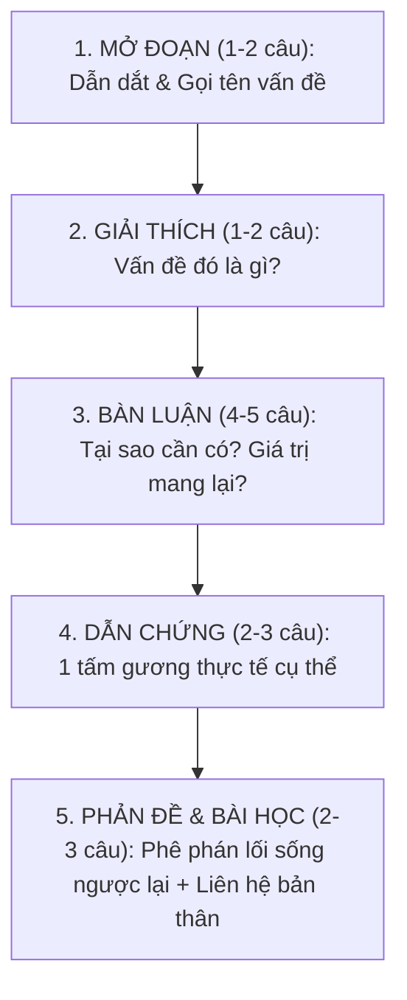

# BỘ CÔNG THỨC VĂN THỰC CHIẾN - CỨU NGUY TỪ 4 LÊN 7.5
### (Thiết kế riêng cho học sinh tư duy tự nhiên: Học Văn theo Công thức & Logic)

---

## LỜI KHUYÊN DÀNH CHO CON:
> *"Viết văn thi vào 10 không phải là sáng tác thơ văn hay bay bổng viển vông. Người chấm thi chấm theo **Ý và BAREM ĐIỂM** của Sở Giáo dục. Chỉ cần con viết đúng công thức, đủ từ khóa (keywords) và lập luận rõ ràng, giám khảo buộc phải cho con điểm tối đa của từng ý đó."*

---

# PHẦN 1: BỘ CÔNG THỨC "ĂN TRỌN ĐIỂM" PHẦN ĐỌC - HIỂU (3.0 - 4.0 ĐIỂM)

Phần này là nơi con có thể lấy trọn vẹn điểm số dễ nhất nếu nhớ các "công thức toán học" sau:

### Công thức 1: Nhận diện Phương thức biểu đạt (PTBĐ)
Khi đề bài hỏi: *"Xác định phương thức biểu đạt chính/các phương thức biểu đạt..."*:
- Nếu có **cốt truyện, nhân vật, diễn biến sự việc** ➔ **Tự sự**.
- Nếu có **tả cảnh vật, chân dung, đường nét, màu sắc** ➔ **Miêu tả**.
- Nếu bộc lộ **tình cảm, cảm xúc cá nhân, thơ ca** ➔ **Biểu cảm**.
- Nếu đưa ra **ý kiến, lập luận, lý lẽ, dẫn chứng để thuyết phục** ➔ **Nghị luận**.
- Nếu giới thiệu **tri thức, số liệu, tính chất sự vật khoa học** ➔ **Thuyết minh**.
- *Mẹo làm bài:* Nếu đề hỏi phương thức biểu đạt **chính** ➔ Chỉ được ghi duy nhất 1 phương thức. Nếu đề hỏi "các phương thức" ➔ Ghi 2 - 3 phương thức.

---

### Công thức 2: Trả lời tác dụng của Biện pháp tu từ (BPTT)
Đây là câu hỏi chiếm từ 0.75 đến 1.0 điểm trong đề thi. **Tuyệt đối không trả lời cộc lốc!**
Áp dụng chuẩn công thức **3 vế bắt buộc**:

> **[CÂU TRẢ LỜI] = [Tên BPTT + Chỉ rõ từ ngữ] + [Tác dụng hình ảnh/nội dung] + [Tác dụng cảm xúc/thái độ]**

* **Vế 1 (Chỉ điểm):** Biện pháp tu từ [So sánh / Ẩn dụ / Điệp từ...] được thể hiện qua từ ngữ/hình ảnh: *"..."*.
* **Vế 2 (Nội dung):** Biện pháp giúp câu văn tăng sức gợi hình, gợi cảm; làm nổi bật hình ảnh [Nêu rõ sự vật/hiện tượng được nói đến].
* **Vế 3 (Cảm xúc):** Qua đó thể hiện tình cảm [yêu thương / kính trọng / tự hào / xót xa...] của tác giả đối với [...].

*Ví dụ minh họa:*
> **Đề bài:** Chỉ ra và nêu tác dụng của BPTT điệp ngữ trong câu thơ: *"Tre xanh xanh tự bao giờ / Chuyện ngày xưa đã có bờ tre xanh"*.
> 
> **Cách trả lời ăn trọn điểm:**
> 1. Biện pháp tu từ: Điệp từ *"xanh"*, điệp hình ảnh *"bờ tre xanh"*.
> 2. Tác dụng nội dung: Nhấn mạnh sức sống bền bỉ, dẻo dai và màu xanh trường tồn của lũy tre làng Việt Nam qua thời gian.
> 3. Tác dụng cảm xúc: Thể hiện niềm tự hào, sự gắn bó tha thiết của nhà thơ với vẻ đẹp bình dị của quê hương đất nước.

---

### Công thức 3: Rút ra Thông điệp / Bài học từ văn bản
Đề thường hỏi: *"Thông điệp ý nghĩa nhất mà anh/chị rút ra từ đoạn trích là gì? Vì sao?"* (0.5 - 1.0 điểm).
- **Cách trả lời:**
  - Chọn 1 thông điệp tích cực, rõ ràng (Ví dụ: Sự kiên trì, lòng biết ơn cha mẹ, trân trọng thời gian, tinh thần sẻ chia).
  - Viết theo cấu trúc 3 câu:
    - *Câu 1:* Thông điệp sâu sắc nhất mà em rút ra từ văn bản là: [Bài học X].
    - *Câu 2 (Vì sao):* Bởi vì trong cuộc sống, [Giải thích ngắn gọn 1 lý do vì sao bài học đó quan trọng].
    - *Câu 3 (Hành động):* Do đó, mỗi chúng ta cần [Nêu 1 việc làm cụ thể để thực hiện bài học đó].

---

# PHẦN 2: CÔNG THỨC 5 BƯỚC VIẾT ĐOẠN VĂN NGHỊ LUẬN XÃ HỘI (2.0 ĐIỂM)

> [!IMPORTANT]
> **Yêu cầu kỹ thuật:** Viết 01 đoạn văn khoảng 200 chữ (tương đương 20 - 25 dòng giấy thi). **Tuyệt đối không xuống dòng tách thành nhiều đoạn** (xuống dòng sẽ bị trừ 0.5 điểm cấu trúc đoạn).

### Bộ khung câu lắp ráp sẵn (Template "Lắp ghép Lego"):

| Bước | Chức năng | Mẫu câu gợi ý để con lắp ráp |
| :--- | :--- | :--- |
| **Bước 1** | **Mở đoạn** | *"Trong hành trình hoàn thiện bản thân để vươn tới thành công, [Vấn đề X: lòng kiên trì / tinh thần tự học...] chính là một trong những hành trang quan trọng và ý nghĩa nhất đối với mỗi con người."* |
| **Bước 2** | **Giải thích** | *"[Vấn đề X] có thể hiểu là [Khái niệm ngắn gọn: nỗ lực không ngừng nghỉ / ý thức tự tìm tòi tri thức mà không cần ai nhắc nhở], giúp con người vượt qua mọi trở ngại."* |
| **Bước 3** | **Bàn luận** | *"Thật vậy, khi sở hữu [Vấn đề X], chúng ta sẽ có đủ bản lĩnh để đối diện với thử thách thay vì nản lòng bỏ cuộc. [Vấn đề X] không chỉ giúp con người mở rộng tri thức, nâng cao giá trị bản thân mà còn tạo dựng niềm tin và sự tôn trọng từ những người xung quanh."* |
| **Bước 4** | **Dẫn chứng** | *"Một minh chứng tiêu biểu cho điều này là [Tên nhân vật cụ thể: Thầy giáo Nguyễn Ngọc Ký / Vận động viên Ánh Viên / Nhà sáng lập Apple Steve Jobs...] - người đã [Nêu ngắn gọn hành động phi thường] để [Kết quả đạt được], trở thành tấm gương sáng cho hàng triệu bạn trẻ."* |
| **Bước 5** | **Phản đề & Bài học** | *"Trái ngược với điều đó, trong xã hội vẫn còn không ít bạn trẻ [lười biếng / ỷ lại / dễ dàng gục ngã trước khó khăn], đó là lối sống đáng bị phê phán. Là một học sinh lớp 9 đang đứng trước ngưỡng cửa kỳ thi vào 10, em tự nhắc nhở bản thân cần rèn luyện [Vấn đề X] ngay từ việc tự giác học tập mỗi ngày để hiện thực hóa ước mơ của mình."* |

---

# PHẦN 3: CÔNG THỨC LẬP Ý NGHỊ LUẬN VĂN HỌC (4.0 - 5.0 ĐIỂM)

Con trai thường bị 4 điểm vì viết văn theo kiểu **"Kể lại câu chuyện" (tóm tắt tác phẩm)** thay vì **"Phân tích ý nghĩa nghệ thuật"**.

### Kỹ thuật viết theo mô hình PEEL (Điểm - Dẫn - Phân - Chốt)
Mỗi một đoạn phân tích trong thân bài, con chỉ cần viết đúng 4 câu theo trình tự:
1. **P (Point - Nêu luận điểm):** Nêu câu chủ đề của đoạn (Ví dụ: *Trước hết, nhân vật anh thanh niên hiện lên với tinh thần trách nhiệm cao và lòng yêu nghề sâu sắc.*)
2. **E (Evidence - Đưa dẫn chứng):** Trích dẫn câu thơ, chi tiết, lời thoại của nhân vật trong tác phẩm.
3. **E (Explanation - Phân tích từ ngữ/hình ảnh):** Mổ xẻ từ ngữ đó hay ở chỗ nào? Thể hiện phẩm chất gì?
4. **L (Link - Nhận xét, chốt ý):** Khẳng định tài năng của tác giả và cảm xúc để lại cho người đọc.

### Bảng công thức Mở bài & Kết bài mẫu (Dùng chung cho mọi đề)

* **Công thức Mở bài chung (Dành cho truyện hoặc thơ):**
  > *"Nhà văn [Tên tác giả] là một trong những cây bút tiêu biểu của nền văn học Việt Nam hiện đại với phong cách sáng tác [giàu chất thơ / chân thực, sâu sắc]. Tác phẩm [Tên tác phẩm] được sáng tác vào năm [...], là bức tranh tuyệt đẹp về [Đề tài: tình yêu quê hương / vẻ đẹp người lao động / tình phụ tử]. Trong đó, để lại ấn tượng sâu đậm nhất trong lòng bạn đọc chính là [Vấn đề đề bài yêu cầu: hình tượng nhân vật X / đoạn thơ Y]."*

* **Công thức Kết bài chung:**
  > *"Tóm lại, bằng ngòi bút tinh tế kết hợp với [nghệ thuật miêu tả tâm lý / ngôn ngữ thơ giàu hình ảnh], tác giả [Tên tác giả] đã khắc họa thành công [Vấn đề nghị luận]. Tác phẩm không chỉ mang giá trị nghệ thuật đặc sắc mà còn khơi gợi trong lòng người đọc bao thế hệ những bài học nhân văn sâu sắc về [tình cảm gia đình / trách nhiệm với Tổ quốc / niềm tin vào cuộc sống]."*

---
*Gợi ý hành động: Hãy in tài liệu này ra hoặc để ngay cạnh bàn học. Mỗi khi con làm bài Văn, mở đúng bảng công thức này ra để "lắp ráp" ý!*
