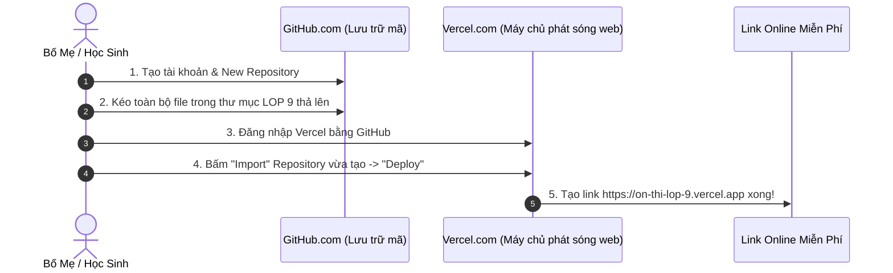
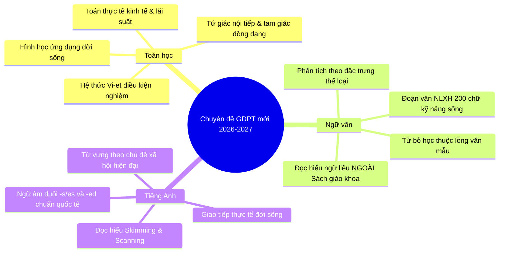

# HƯỚNG DẪN TỪNG BƯỚC (STEP-BY-STEP) DEPLOY LÊN VERCEL MIỄN PHÍ 100%
### HỆ THỐNG ÔN THI VÀO 10 THPT TRẦN PHÚ (VĨNH YÊN) - NĂM HỌC 2026-2027

---

## 1. TỔNG QUAN GIẢI PHÁP WEB & ĐỒNG BỘ MIỄN PHÍ

Toàn bộ mã nguồn trang web đã được tạo sẵn trong thư mục `c:\Users\Administrator\Downloads\LOP 9` gồm:
- `index.html`: Dashboard chính, Đồng hồ Pomodoro, Bảng theo dõi tiến độ 21 ca học, Sổ tay lỗi sai, Công cụ đồng bộ.
- `toan.html`: Chuyên đề Toán thi vào 10 (2026-2027), Toán thực tế, Barem điểm & Trắc nghiệm tương tác chấm điểm ngay.
- `van.html`: Cứu nguy môn Văn từ 4 lên 7.5, Công cụ lắp ghép đoạn văn NLXH 200 chữ tự động, Kỹ năng đọc hiểu ngoài SGK.
- `anh.html`: Chuyên đề Tiếng Anh (8.5+), Thần chú phát âm - trọng âm, 7 cấu trúc ngữ pháp vàng & Trắc nghiệm chấm điểm.
- `style.css`: Giao diện tối ưu di động và máy tính, màu sắc khoa học.
- `app.js`: Xử lý âm thanh, tính điểm, đếm Pomodoro và lưu trữ dữ liệu.
- `vercel.json`: Cấu hình máy chủ Vercel tối ưu, tốc độ tải trang cực nhanh.

> [!NOTE]
> **Vercel Hobby Plan** là gói dịch vụ **hoàn toàn miễn phí trọn đời**, hỗ trợ tên miền bảo mật SSL (`https://...`), băng thông không giới hạn cho mục đích học tập cá nhân.

---

## 2. HƯỚNG DẪN DEPLOY LÊN VERCEL (2 CÁCH DỄ NHẤT - KHÔNG CẦN CÀI ĐẶT PHẦN MỀM)

Do máy tính hiện chưa cài đặt Node.js hay Git, bạn hãy sử dụng **Cách 1 (Kéo thả qua GitHub Web)** - Đây là cách chuẩn nhất, chỉ mất đúng 2 phút và sau này muốn sửa gì cũng cập nhật tự động.

### CÁCH 1: DEPLOY QUA GITHUB WEB & VERCEL (KHUYÊN DÙNG - 2 PHÚT)



#### Bước 1: Đưa mã nguồn lên GitHub (Miễn phí)
1. Truy cập [https://github.com/](https://github.com/) và đăng ký tài khoản (nếu chưa có).
2. Sau khi đăng nhập, bấm vào dấu **`+`** ở góc phải trên cùng $\rightarrow$ Chọn **`New repository`**.
3. Điền tên: `on-thi-vao-10-tran-phu` $\rightarrow$ Chọn chế độ **`Public`** $\rightarrow$ Bấm nút xanh **`Create repository`**.
4. Ở trang hiển thị tiếp theo, tìm dòng chữ: *"uploading an existing file"* (hoặc bấm vào nút **`Add file`** $\rightarrow$ **`Upload files`**).
5. Mở thư mục `c:\Users\Administrator\Downloads\LOP 9` trên máy tính, **chọn toàn bộ các file sau và kéo thả vào trình duyệt**:
   - `index.html`
   - `toan.html`
   - `van.html`
   - `anh.html`
   - `style.css`
   - `app.js`
   - `vercel.json`
6. Đợi thanh tải lên chạy đủ các file $\rightarrow$ Kéo xuống dưới bấm nút xanh **`Commit changes`**.

---

#### Bước 2: Liên kết và Deploy trên Vercel (1 Click)
1. Mở trang [https://vercel.com/](https://vercel.com/) $\rightarrow$ Bấm **`Sign Up`** hoặc **`Log In`** $\rightarrow$ Chọn **`Continue with GitHub`** (Đăng nhập cùng tài khoản GitHub vừa tạo ở Bước 1).
2. Sau khi vào màn hình chính của Vercel (Dashboard), bấm nút **`Add New...`** $\rightarrow$ Chọn **`Project`**.
3. Bạn sẽ nhìn thấy danh sách các repository của mình, bấm nút **`Import`** cạnh repository `on-thi-vao-10-tran-phu`.
4. Giữ nguyên toàn bộ cài đặt mặc định (Framework Preset: *Other*, Root Directory: *./*).
5. Bấm nút xanh **`Deploy`**.
6. Đợi khoảng 15 - 20 giây, màn hình Vercel sẽ bắn pháo hoa chúc mừng! 
   - Vercel sẽ cấp ngay cho bạn một đường link miễn phí trọn đời có dạng:  
     👉 **`https://on-thi-vao-10-tran-phu.vercel.app`**
7. Bạn chỉ cần gửi đường link này vào Zalo để con mở trên điện thoại, máy tính bảng hoặc máy tính để học tập bất cứ lúc nào!

---

### CÁCH 2: DÙNG VERCEL CLI (DÀNH CHO NGƯỜI THÍCH DÒNG LỆNH)

Nếu sau này bạn muốn triển khai bằng dòng lệnh từ máy tính:
1. Tải và cài đặt Node.js từ [https://nodejs.org/](https://nodejs.org/).
2. Mở PowerShell trong thư mục `LOP 9` và chạy 2 lệnh:
   ```powershell
   npm install -g vercel
   vercel --prod
   ```
3. Đăng nhập theo hướng dẫn trên màn hình, hệ thống sẽ tự động deploy toàn bộ thư mục lên Vercel trong 30 giây.

---

## 3. CƠ CHẾ ĐỒNG BỘ 100% MIỄN PHÍ GIỮA ĐIỆN THOẠI VÀ MÁY TÍNH

Để hệ thống hoạt động mượt mà, **không tốn chi phí thuê máy chủ (serverless)** và **bảo mật riêng tư 100%**, trang web được tích hợp sẵn 2 cơ chế đồng bộ:

### Cơ chế 1: Lưu trữ tự động tại máy (Local Offline/Online)
- Mọi thao tác: Bật đồng hồ Pomodoro, tích dấu vào bảng 21 ca học tuần, ghi chú lỗi sai vào Sổ tay đều được lưu tức thời vào bộ nhớ trình duyệt (`localStorage`).
- Dù tắt mạng hay mất wifi, dữ liệu vẫn được bảo toàn nguyên vẹn.

### Cơ chế 2: Đồng bộ 1 chạm qua "Mã Sao Lưu" (1-Click Sync)
- **Kịch bản thực tế:** Con học trên điện thoại và đã tích hoàn thành 5 ca học cùng 2 lỗi sai môn Toán. Bố mẹ muốn xem tiến độ trên máy tính ở cơ quan:
  1. Trên điện thoại của con, vào mục *"Đồng bộ dữ liệu"* ở cuối trang $\rightarrow$ Bấm nút **`Xuất Mã Sao Lưu (Copy)`**.
  2. Con gửi đoạn mã đó qua Zalo cho bố mẹ.
  3. Bố mẹ mở web trên máy tính $\rightarrow$ Dán mã đó vào ô văn bản $\rightarrow$ Bấm **`Đồng Bộ Dữ Liệu Vào Máy Này`**.
  4. Ngay lập tức, màn hình máy tính của bố mẹ sẽ hiển thị chính xác 100% tiến độ và các lỗi sai con vừa cập nhật!

---

## 4. CẬP NHẬT CÁC NỘI DUNG CHUYÊN ĐỀ MỚI NHẤT NĂM HỌC 2026-2027

Toàn bộ 3 module môn học trên web đã được biên soạn và cập nhật theo đúng chuẩn **Chương trình GDPT 2018 (Áp dụng chính thức cho kỳ thi tuyển sinh lớp 10 năm học 2026 - 2027)**:



1. **Môn Toán:**
   - Đưa các bài toán ứng dụng thực tế vào trọng tâm: Tính tiền điện thoại, chiết khấu phần trăm siêu thị, lãi suất vay vốn, thể tích thùng chứa hình trụ/nón/cầu.
   - Giảm tải các mẹo vặt bất đẳng thức cổ điển quá phức tạp, tăng cường bài toán tư duy mô hình hóa.
2. **Môn Ngữ văn:**
   - Tuyệt đối không dùng lại văn bản đã học trong SGK để ra đề Đọc hiểu và Nghị luận xã hội (tránh tình trạng học tủ, chép văn mẫu).
   - Trang bị công cụ sinh dàn ý 5 bước tự động để con rèn luyện tư duy phản xạ viết nhanh, viết chuẩn theo barem điểm.
3. **Môn Tiếng Anh:**
   - Tập trung vào kỹ năng ngôn ngữ thực tiễn: Đọc văn bản thông tin, nhận biết biển báo, chức năng giao tiếp hàng ngày và kỹ năng viết lại câu chuyển đổi thì ngữ pháp.

---
*Chúc phụ huynh triển khai thành công trang web để con trai có một công cụ học tập trực quan, hiện đại và tràn đầy cảm hứng thi đỗ THPT Trần Phú!*
