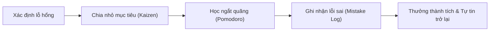
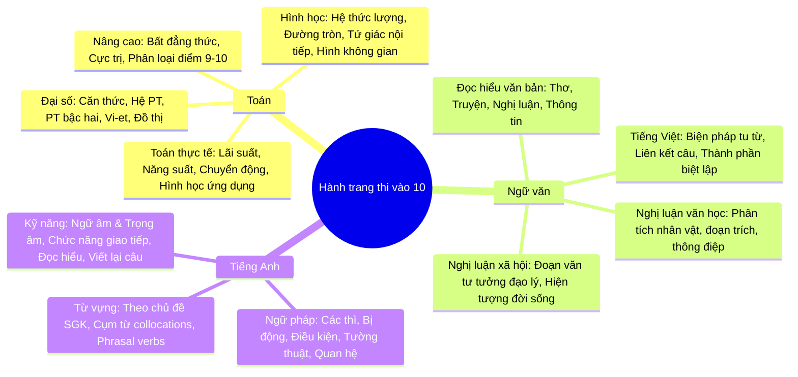
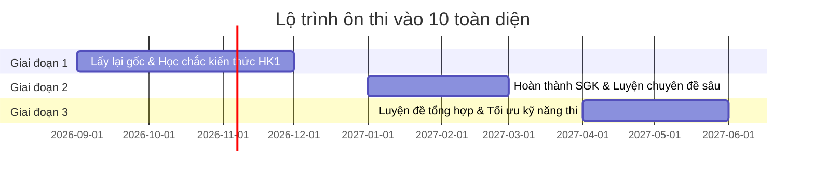

# KẾ HOẠCH CHIẾN LƯỢC ÔN THI VÀO LỚP 10 DÀNH CHO HỌC SINH LỚP 9 (TOÁN - VĂN - TIẾNG ANH)

---

## LỜI NÓI ĐẦU DÀNH CHO PHỤ HUYNH

Ở lứa tuổi 14 - 15 (học sinh lớp 9), biểu hiện **"lười học"** đa phần xuất phát từ 3 nguyên nhân cốt lõi:
1. **Bị hổng kiến thức căn bản:** Khi ngồi vào bàn học mà không hiểu bài, con sẽ có cảm giác bất lực, chán nản và sinh ra phản xạ trốn tránh (lướt điện thoại, chơi game, ngủ gục).
2. **Mục tiêu mơ hồ, thiếu động lực tự thân:** Con chưa thấy được việc đỗ vào trường cấp 3 mong muốn có ý nghĩa gì đối với bản thân ngoài việc "bố mẹ muốn thế".
3. **Cám dỗ của dopamine ngắn hạn:** Game, mạng xã hội (TikTok, Facebook, YouTube) đem lại sự thỏa mãn tức thì, trong khi việc học cần sự kiên trì và kỷ luật.

> [!IMPORTANT]
> **Nguyên tắc vàng:** Muốn con hết lười, cha mẹ cần chuyển vai trò từ **"Người giám sát/Cảnh sát"** sang **"Huấn luyện viên/Người đồng hành"**. Không dùng đòn roi hay cằn nhằn liên tục (sẽ gây phản ứng chống đối ngầm), thay vào đó dùng **Quy tắc thỏa thuận rõ ràng - Chia nhỏ mục tiêu - Khen thưởng thành quả ngay khi có tiến bộ nhỏ**.

---

## PHẦN 1: CHIẾN THUẬT TÂM LÝ & PHƯƠNG PHÁP HỌC CHỐNG LƯỜI HIỆU QUẢ

### 1. Phương pháp "Bậc thang nhỏ" (Nguyên tắc Kaizen)
- Học sinh lười rất sợ một chồng bài tập dày cộp. Nếu bảo con: *"Hôm nay phải làm hết 1 đề Toán 5 câu"*, con sẽ trì hoãn đến khuya rồi bỏ dở.
- **Cách khắc phục:** Chia nhỏ mục tiêu. 
  - *"Tối nay con chỉ cần giải đúng 2 câu rút gọn biểu thức và 1 bài giải phương trình trong 25 phút"*.
  - Khi hoàn thành được bài dễ, cảm giác "thành công nho nhỏ" (Quick win) sẽ kích thích não bộ tiết ra dopamine tích cực, giúp con tự tin làm tiếp bài sau.

### 2. Kỹ thuật Pomodoro (Học sâu từng chặng 25 - 5 phút)
- **Chu kỳ 1:** Học tập trung cao độ 25 phút (tuyệt đối không điện thoại, không mạng xã hội).
- **Nghỉ ngắn:** 5 phút (đứng dậy uống nước, vươn vai, không cầm điện thoại).
- Sau 4 chu kỳ Pomodoro (khoảng 2 tiếng), cho con nghỉ dài 15 - 20 phút.
- *Lợi ích:* Con không có cảm giác bị "giam cầm" ở bàn học hàng giờ liền, não bộ duy trì được sự tập trung cao nhất.

### 3. Quy tắc "Quản lý thiết bị điện tử thông minh"
- Không cấm đoán cực đoan (dễ gây ức chế, lén lút dùng ban đêm).
- Thiết lập quy tắc: Khi ngồi vào bàn học, điện thoại để ở phòng khách hoặc nhờ bố mẹ giữ giúp. Sau khi hoàn thành đúng khối lượng bài của buổi tối, con được tự do sử dụng 30 - 45 phút trước khi đi ngủ.

### 4. Cuốn sổ tay "Vũ khí bí mật" - Sổ lỗi sai (Mistake Notebook)
- Người học giỏi khác người học kém ở chỗ: **Họ không bao giờ để sai lại cùng một lỗi 2 lần**.
- Chuẩn bị 3 cuốn vở mỏng cho 3 môn. Bất cứ khi nào làm sai một bài, con phải chép lại đề, ghi rõ:
  - *Tại sao mình sai?* (Đọc thiếu đề? Nhầm dấu? Quên điều kiện? Không thuộc công thức?).
  - *Lời giải chuẩn là gì?*
  - Xem lại cuốn sổ này trước mỗi bài kiểm tra trên lớp và trước kỳ thi.

---

## PHẦN 2: TỔNG HỢP KIẾN THỨC TỪ CƠ BẢN ĐẾN NÂNG CAO (3 MÔN CHÍNH)

*(Cập nhật theo định hướng chương trình GDPT mới: Chú trọng thực tiễn, tư duy logic, không học vẹt)*

---

### MÔN 1: TOÁN HỌC (Chiếm hệ số cao, phân hóa rõ rệt)

#### 1. Mức độ Cơ bản (Mục tiêu: Đạt 5.0 - 6.5 điểm - Nắm chắc để không mất gốc)
- **Căn bậc hai, căn bậc ba:**
  - Điều kiện xác định của biểu thức chứa căn: Biểu thức dưới căn A ≥ 0.
  - Các phép biến đổi đơn giản: Khai phương, đưa thừa số ra/vào dấu căn, trục căn thức ở mẫu.
  - Bài toán rút gọn biểu thức chứa biến và tính giá trị của biểu thức tại x = x₀.
- **Hệ phương trình bậc nhất hai ẩn:**
  - Giải hệ bằng phương pháp thế và phương pháp cộng đại số.
  - Giải bài toán bằng cách lập hệ phương trình (dạng toán cơ bản: tìm số, tính toán đơn giản).
- **Phương trình bậc hai một ẩn:**
  - Công thức nghiệm và công thức nghiệm thu gọn (Δ và Δ′).
  - Định lý Vi-ét: Tính tổng S = x₁ + x₂ = −b/a và tích P = x₁x₂ = c/a.
  - Nhẩm nghiệm theo trường hợp đặc biệt: a + b + c = 0 hoặc a − b + c = 0.
- **Hàm số và đồ thị:**
  - Hàm số bậc nhất y = ax + b: Vẽ đồ thị, tính đồng biến/nghịch biến, vị trí tương đối của hai đường thẳng (song song, cắt nhau, trùng nhau).
  - Đồ thị Parabol y = ax² (với a ≠ 0).
- **Hình học cơ bản:**
  - Hệ thức lượng trong tam giác vuông (tính cạnh, góc, đường cao, hình chiếu).
  - Tỉ số lượng giác: sin, cos, tan, cot.
  - Tính chất tiếp tuyến của đường tròn.
  - Công thức diện tích xung quanh, thể tích các khối hình học không gian thực tế (Hình trụ, Hình nón, Hình cầu).

#### 2. Mức độ Khá (Mục tiêu: Đạt 7.0 - 8.5 điểm - Trọng tâm thi đỗ công lập top đầu)
- **Rút gọn biểu thức nâng cao & câu hỏi phụ:**
  - Tìm giá trị của x để biểu thức đạt giá trị nguyên (P ∈ ℤ).
  - Tìm x để P > m, P < m, so sánh P với √P hoặc |P|.
- **Phương trình bậc hai & Ứng dụng Vi-ét có điều kiện:**
  - Tìm tham số m để phương trình có 2 nghiệm phân biệt thỏa mãn điều kiện đối xứng: x₁² + x₂² = k, 1/x₁ + 1/x₂ = k, |x₁ − x₂| = k.
  - Điều kiện không đối xứng: x₁ = 2x₂, x₁² + 2x₂ = k.
  - Tương giao giữa Parabol (P): y = ax² và đường thẳng (d): y = mx + n.
- **Giải bài toán bằng cách lập phương trình / hệ phương trình dạng thực tế:**
  - Toán chuyển động (ngược dòng / xuôi dòng, cùng chiều / ngược chiều).
  - Toán năng suất (làm chung, làm riêng, vượt năng suất).
  - Toán kinh tế / phần trăm (lãi suất ngân hàng, giảm giá khuyến mãi, pha trộn dung dịch).
- **Hình học chứng minh:**
  - Chứng minh tứ giác nội tiếp đường tròn (4 phương pháp: tổng hai góc đối diện bằng 180°, hai đỉnh kề cùng nhìn một cạnh, góc ngoài bằng góc đối trong, cách đều một điểm).
  - Chứng minh hệ thức hình học (AB · AC = AD · AE) bằng tam giác đồng dạng.
  - Chứng minh tiếp tuyến, đường thẳng vuông góc, song song, đồng quy hoặc thẳng hàng.

#### 3. Mức độ Nâng cao (Mục tiêu: Chinh phục điểm 9.0 - 10.0)
- **Bất đẳng thức & Cực trị:**
  - Bất đẳng thức Cauchy (AM-GM), Bunhiacopxki, Cauchy-Schwarz dạng phân thức (Bất đẳng thức Schwarz).
  - Kỹ thuật chọn điểm rơi, thêm bớt hạng tử, đổi biến số.
- **Hình học phân loại câu cuối:**
  - Cực trị hình học (tìm vị trí điểm để đoạn thẳng/diện tích lớn nhất, nhỏ nhất).
  - Điểm cố định khi một yếu tố thay đổi.
- **Phương trình vô tỉ:** Phương pháp đặt ẩn phụ, nhân liên hợp, đánh giá hai vế.

---

### MÔN 2: NGỮ VĂN (Kỹ năng, cảm xúc và tư duy lập luận)

> [!NOTE]
> Theo xu hướng ra đề thi mới, phần lớn các tỉnh thành sử dụng **ngữ liệu ĐỌC HIỂU và NGHỊ LUẬN ngoài Sách giáo khoa**. Do đó, tuyệt đối không được cho con học thuộc lòng văn mẫu, mà phải học **CÔNG THỨC VÀ KỸ NĂNG**.

#### 1. Mức độ Cơ bản (Nắm chắc kỹ thuật: 5.0 - 6.5 điểm)
- **Kỹ năng Đọc - Hiểu văn bản:**
  - Nhận biết thể loại: Thơ (lục bát, tự do, 5 chữ...), Truyện ngắn, Tản văn, Ký, Văn bản nghị luận, Văn bản thông tin.
  - Xác định phương thức biểu đạt (Tự sự, Miêu tả, Biểu cảm, Nghị luận, Thuyết minh, Hành chính công vụ).
  - Xác định ngôi kể và tác dụng của ngôi kể (Ngôi thứ nhất, ngôi thứ ba).
  - Nhận diện các biện pháp tu từ: So sánh, Ẩn dụ, Hoán dụ, Nhân hóa, Điệp từ/ngữ, Nói giảm nói tránh, Liệt kê, Tương phản.
  - Kiến thức Tiếng Việt: Khởi ngữ, các thành phần biệt lập (tình thái, cảm thán, gọi - đáp, phụ chú), các phép liên kết câu (lặp, thế, nối, đồng nghĩa - trái nghĩa).
- **Kỹ năng trả lời câu hỏi đọc hiểu:**
  - Trả lời ngắn gọn, đúng trọng tâm, đi thẳng vào câu hỏi, tránh lan man.
  - Luôn trình bày theo cấu trúc: Chỉ ra từ ngữ/chi tiết ➔ Nêu tác dụng nội dung ➔ Nêu tác dụng nghệ thuật/cảm xúc.

#### 2. Mức độ Khá (Lập luận chắc chắn, cảm xúc: 7.0 - 8.0 điểm)
- **Viết đoạn văn Nghị luận xã hội (khoảng 200 chữ / 2/3 trang giấy thi):**
  - **Dạng 1: Nghị luận về một tư tưởng, đạo lý** (lòng biết ơn, sự kiên trì, lòng dũng cảm, tinh thần tự học...).
  - **Dạng 2: Nghị luận về một hiện tượng đời sống** (bạo lực học đường, nghiện mạng xã hội, ô nhiễm môi trường, văn hóa ứng xử nơi công cộng...).
  - **Công thức vàng viết đoạn văn 5 bước:**
    1. *Mở đoạn:* Dẫn dắt và nêu trực tiếp vấn đề cần bàn luận (1 - 2 câu).
    2. *Giải thích:* Khái niệm/vấn đề đó nghĩa là gì? (1 - 2 câu).
    3. *Bàn luận & Phân tích:* Tại sao lại như vậy? Ý nghĩa/tác hại là gì? (4 - 5 câu).
    4. *Dẫn chứng thực tế:* Nêu 1 dẫn chứng tiêu biểu, xác thực, truyền cảm hứng (tránh dẫn chứng chung chung, bịa đặt).
    5. *Phản đề & Bài học hành động:* Lên án biểu hiện tiêu cực trái ngược ➔ Rút ra bài học cho bản thân học sinh (2 - 3 câu).
- **Kỹ năng viết bài văn Nghị luận văn học cơ bản:**
  - Bố cục 3 phần rõ ràng: Mở bài (giới thiệu tác giả, tác phẩm, vấn đề nghị luận), Thân bài (các luận điểm phân tích), Kết bài (đánh giá tổng kết và cảm nghĩ).
  - Thuộc dẫn chứng, thơ, chi tiết đắt giá của tác phẩm để trích dẫn.

#### 3. Mức độ Nâng cao (Văn phong mượt mà, sâu sắc: 8.5 - 9.5 điểm)
- **Lý luận văn học ứng dụng:**
  - Biết đưa nhận định văn học phù hợp vào mở bài hoặc kết bài để bài viết có chiều sâu.
  - Hiểu về đặc trưng thể loại (thi pháp thơ, tình huống truyện, ngôn ngữ nhân vật, điểm nhìn trần thuật).
- **So sánh, liên hệ mở rộng:**
  - So sánh vẻ đẹp của hai nhân vật, hai đoạn thơ có cùng chủ đề để thấy sự độc đáo trong phong cách mỗi tác giả.
  - Liên hệ vấn đề văn học với thực tiễn đời sống hôm nay.

---

### MÔN 3: TIẾNG ANH (Môn dễ gỡ điểm nhất nếu có chiến thuật tích lũy)

#### 1. Mức độ Cơ bản (Chống liệt & đạt điểm khá: 5.0 - 6.5 điểm)
- **Hệ thống thì cốt lõi (Tenses):**
  - Hiện tại đơn (Present Simple) & Hiện tại tiếp diễn (Present Continuous).
  - Quá khứ đơn (Past Simple) & Quá khứ tiếp diễn (Past Continuous).
  - Tương lai đơn (Future Simple) & Tương lai gần (Be going to).
  - Hiện tại hoàn thành (Present Perfect - đặc biệt chú ý dấu hiệu *since, for, already, yet, ever, never*).
- **Ngữ pháp trọng điểm thường xuất hiện trong đề thi:**
  - **Câu bị động (Passive Voice):** Bị động các thì cơ bản và Modal verbs (S + be + V_pp).
  - **Câu điều kiện (Conditionals):** Loại 1 (If + V_s/es, S + will + V_0) và Loại 2 (If + V_ed/were, S + would + V_0).
  - **Câu tường thuật (Reported Speech):** Quy tắc lùi thì, đổi ngôi đại từ, đổi trạng từ chỉ nơi chốn/thời gian.
  - **So sánh tính từ & trạng từ:** So sánh bằng, so sánh hơn, so sánh nhất.
  - **Mệnh đề quan hệ (Relative Clauses):** Cách dùng *Who, Whom, Which, That, Whose, Where, When*.
- **Ngữ âm (Phonetics):**
  - Quy tắc phát âm đuôi -s / -es (phương pháp nhớ thần chú: *thời phong kiến phương tây*...).
  - Quy tắc phát âm đuôi -ed (nhớ: *t, d* phát âm là /ɪd/, *chính phủ pháp k...* phát âm là /t/).
  - Trọng âm từ 2 âm tiết (danh từ/tính từ thường nhấn âm 1, động từ thường nhấn âm 2).

#### 2. Mức độ Khá (Vững vàng đạt 7.5 - 8.5 điểm)
- **Từ vựng theo chủ đề chương trình lớp 9:**
  - Local environment (Môi trường địa phương, làng nghề truyền thống).
  - City life (Cuộc sống thành thị, giao thông, chi phí sống).
  - Teen stress and pressure (Áp lực học tập, tâm lý tuổi dậy thì).
  - Life in the past (Cuộc sống xưa, phong tục, ký ức tuổi thơ).
  - Wonders of Vietnam (Danh lam thắng cảnh Việt Nam).
  - Natural wonders, Space travel, Tourism, English in the world.
- **Cụm động từ (Phrasal Verbs thông dụng):**
  - *Look for, look after, look up, turn on/off, give up, take off, put on, find out, set up, break down...*
- **Cấu trúc câu viết lại (Sentence Transformation):**
  - Chuyển đổi giữa thì Quá khứ đơn ➔ Hiện tại hoàn thành (*The last time I saw him was 2 years ago ➔ I haven't seen him for 2 years*).
  - Chuyển đổi giữa *Because / Because of*, *Although / In spite of*.
  - Cấu trúc *So... that... / Such... that... / Too... to... / Enough to...*
  - Cấu trúc gợi ý: *Suggest + V-ing / Suggest that S + (should) + V_0*.
  - Ước muốn: *Wish + Quá khứ đơn* (ước cho hiện tại).

#### 3. Mức độ Nâng cao (Chinh phục 9.0 - 10.0 điểm)
- **Collocations & Idioms phổ biến:** Các cụm từ cố định đi cùng nhau (*make a decision, take responsibility, pay attention, break a leg, piece of cake...*).
- **Mệnh đề quan hệ rút gọn:** Rút gọn bằng V-ing (chủ động), V-ed/V3 (bị động), To-V (khi có *the first, the only, so sánh nhất*).
- **Kỹ năng làm bài đọc hiểu dài (Reading Comprehension):**
  - Kỹ thuật Skimming (đọc lướt tìm ý chính).
  - Kỹ thuật Scanning (quét nhanh tìm số liệu, tên riêng, từ khóa).
  - Kỹ năng đoán nghĩa từ vựng trong ngữ cảnh.

---

## PHẦN 3: LỘ TRÌNH ÔN THI 3 GIAI ĐOẠN CHI TIẾT

### Giai đoạn 1: Lấy lại gốc & Xây nền tảng vững chắc (Tháng 9 - Tháng 12)
- **Mục tiêu:** Bù đắp mọi lỗ hổng từ lớp 8, nắm chắc toàn bộ lý thuyết và bài tập cơ bản trong Sách giáo khoa học kỳ 1.
- **Hành động cụ thể:**
  - *Toán:* Làm thuần thục các dạng bài tính toán căn thức, vẽ đồ thị, giải hệ phương trình và chứng minh hình học mức độ 1-2 bước.
  - *Văn:* Thuộc lòng các công thức ngữ pháp Tiếng Việt, nắm chắc dàn ý viết đoạn văn nghị luận xã hội 200 chữ.
  - *Tiếng Anh:* Mỗi tuần học thuộc 25 - 30 từ vựng theo chủ đề; giải thành thạo 5 thì cơ bản, câu bị động và câu điều kiện.
- **Đánh giá cuối kỳ 1:** Điểm thi trên lớp phải đạt từ 6.5 trở lên.

### Giai đoạn 2: Tăng tốc chuyên đề & Nâng cao kỹ năng (Tháng 1 - Tháng 3)
- **Mục tiêu:** Hoàn thành sớm chương trình Sách giáo khoa học kỳ 2 (vào khoảng cuối tháng 2 hoặc đầu tháng 3) và bắt đầu ôn tập theo từng chuyên đề chuyên sâu.
- **Hành động cụ thể:**
  - *Toán:* Ôn chuyên đề Phương trình bậc 2 & Hệ thức Vi-ét có chứa tham số m; Chuyên đề Toán thực tế; Chuyên đề Tứ giác nội tiếp và các bổ đề hình học hay gặp.
  - *Văn:* Luyện viết đều đặn 1 đoạn văn nghị luận xã hội và 1 bài văn nghị luận tác phẩm mỗi tuần; nhờ thầy cô chấm và sửa chi tiết.
  - *Tiếng Anh:* Luyện chuyên đề viết lại câu, đọc hiểu điền từ và phân tích ngữ âm, trọng âm để không bị mất điểm oan ở các câu nhận biết.

### Giai đoạn 3: Luyện đề tổng hợp & Chuẩn hóa tâm lý phòng thi (Tháng 4 - Tháng 6)
- **Mục tiêu:** Bấm giờ làm đề thi chính thức của các năm trước và đề thi thử của các trường chuyên, trường top.
- **Hành động cụ thể:**
  - Bấm đúng thời gian thực tế: Toán (90 - 120 phút), Văn (90 - 120 phút), Anh (60 phút).
  - Tần suất: Mỗi tuần giải từ 1 đến 2 đề/môn.
  - Sau khi làm xong: **Quan trọng nhất là khâu chấm chữa và cập nhật vào Sổ lỗi sai**. Tìm hiểu vì sao câu đó sai, ghi chú lại mẹo tránh bẫy.
  - Rèn luyện kỹ năng trình bày sạch sẽ, rõ ràng (đặc biệt với môn Tự luận như Toán và Văn).

---

## PHẦN 4: THỜI KHÓA BIỂU KHOA HỌC (TỐI & CUỐI TUẦN)

> [!TIP]
> **Nguyên tắc phân bổ:** 
> 1. Không xếp 2 môn tư duy nặng liên tiếp (ví dụ không học liền 2 tiếng Toán rồi sang 1 tiếng Lý).
> 2. Luôn có 1 môn "nhẹ nhàng" xen kẽ môn "nặng".
> 3. Tuyệt đối không thức sau 23h00 vì não bộ ở tuổi dậy thì cần ngủ đủ 7 - 8 tiếng để ghi nhớ dài hạn.

### 1. Thời khóa biểu Buổi Tối các ngày trong tuần (Thứ Hai đến Thứ Sáu)

- **Tổng thời lượng:** 2 tiếng 15 phút (Khoảng từ **19h45 đến 22h15**)
- **Mô hình học:** 2 ca học tập trung (mỗi ca 50 phút), giải lao giữa ca 15 phút.

| Thứ | Ca 1 (19h45 - 20h35) | Giải lao (20h35 - 20h50) | Ca 2 (20h50 - 21h40) | Ca phụ nhẹ (21h50 - 22h15) |
| :--- | :--- | :--- | :--- | :--- |
| **Thứ 2** | **TOÁN (Đại số):** Rút gọn, PT/HPT, lý thuyết mới | Uống nước, vận động nhẹ, không lướt điện thoại | **TIẾNG ANH:** Học 1 chuyên đề ngữ pháp + 10 câu trắc nghiệm | Học 10 từ vựng Anh qua Flashcard/sổ tay |
| **Thứ 3** | **NGỮ VĂN:** Đọc hiểu văn bản + Ôn tiếng Việt | Thư giãn, nghe 1 bản nhạc nhẹ | **TOÁN (Hình học):** Vẽ hình, chứng minh 2 câu đầu | Đọc 1 bài văn mẫu hoặc bài báo hay |
| **Thứ 4** | **TIẾNG ANH:** Luyện đọc hiểu + Làm bài viết lại câu | Ăn hoa quả, thư giãn mắt | **TOÁN (Đại số):** Chuyên đề giải bài toán bằng lập PT | Xem lại các công thức Toán trong tuần |
| **Thứ 5** | **NGỮ VĂN:** Luyện viết 1 đoạn văn Nghị luận xã hội | Vận động nhẹ, trò chuyện với bố mẹ | **TIẾNG ANH:** Luyện ngữ âm, trọng âm, cụm từ vựng | Đọc lại đoạn văn vừa viết để sửa câu từ |
| **Thứ 6** | **TOÁN (Hình học):** Tứ giác nội tiếp, hệ thức lượng | Nghe nhạc, thư giãn | **XỬ LÝ BÀI TẬP VỀ NHÀ** của các môn trên lớp ngày hôm sau | Lên kế hoạch cho 2 ngày cuối tuần |

---

### 2. Thời khóa biểu Cuối Tuần (Thứ Bảy & Chủ Nhật)

Cuối tuần là thời điểm vàng để **bù đắp kiến thức còn yếu** và **luyện đề thực chiến**, đồng thời vẫn phải có khoảng nghỉ thể thao để giải phóng năng lượng cho con.

#### Ngày THỨ BẢY:
- **Buổi sáng (Tự do/Thư giãn):** Con được ngủ dậy muộn hơn ngày thường (khoảng 7h30), dọn dẹp phòng, giúp việc nhà.
- **Buổi chiều (14h30 - 17h00):**
  - **14h30 - 15h45 (75 phút):** **TOÁN CHUYÊN SÂU** (Làm bài tập tổng hợp hoặc bổ sung dạng bài con đang yếu nhất trong tuần).
  - *Nghỉ giải lao 15 phút.*
  - **16h00 - 17h00 (60 phút):** **TIẾNG ANH** (Làm trọn vẹn 1 đề thi thử Tiếng Anh 50 câu).
- **Buổi chiều tối (17h00 - 19h30):** Chơi thể thao (bóng rổ, đá bóng, cầu lông, chạy bộ), tắm rửa, ăn cơm cùng gia đình.
- **Buổi tối (19h45 - 21h30):**
  - Chữa chi tiết đề Tiếng Anh đã làm chiều nay, ghi từ mới và cấu trúc sai vào sổ.
  - Ôn nhẹ lại từ vựng.
- **Sau 21h30:** Con được tự do giải trí (chơi game, xem phim, lướt web) đúng theo thỏa thuận nếu đã hoàn thành bài.

#### Ngày CHỦ NHẬT:
- **Buổi sáng (08h00 - 10h30):**
  - **08h00 - 10h00 (120 phút):** **THỰC CHIẾN MÔN TOÁN** (Làm 1 đề tổng hợp có bấm giờ nghiêm túc).
  - **10h00 - 10h30:** Đối chiếu đáp án, tự chấm điểm, khoanh tròn các chỗ bị sai sót.
- **Buổi chiều (14h30 - 16h45):**
  - **14h30 - 16h30 (120 phút):** **THỰC CHIẾN MÔN VĂN** (Luyện viết 1 đề thi Văn hoàn chỉnh gồm phần Đọc hiểu, Nghị luận xã hội và Nghị luận văn học).
  - **16h30 - 17h30:** Đi dạo, tham gia hoạt động ngoài trời cùng gia đình.
- **Buổi tối (19h45 - 21h15): TỔNG KẾT TUẦN & CHUẨN BỊ TUẦN MỚI**
  - Soạn sẵn sách vở cho ngày Thứ Hai.
  - Cùng bố mẹ điểm lại: Trong tuần qua con đã tiến bộ ở điểm nào? Còn nợ phần bài nào chưa hiểu?
  - Viết ra 3 mục tiêu cụ thể cần đạt trong tuần tới.
  - Đi ngủ sớm trước 22h30 để nạp năng lượng cho tuần mới.

---

## PHẦN 5: CẨM NANG HÀNH ĐỘNG DÀNH CHO BỐ MẸ

| Việc NÊN làm | Việc TUYỆT ĐỐI TRÁNH |
| :--- | :--- |
| **Khen ngợi nỗ lực cụ thể:** *"Bố thấy hôm nay con ngồi tập trung được đúng 50 phút mà không ngó điện thoại, rất đáng khen!"* | **Chê bai khái quát:** *"Mày lười như hủi, suốt ngày cắm mặt vào điện thoại thì thi thố cái gì!"* |
| **Tạo góc học tập yên tĩnh:** Bàn học gọn gàng, đủ ánh sáng, bố mẹ không xem tivi bật tiếng quá to ngay cạnh bàn học của con. | **So sánh với "con nhà người ta":** So sánh chỉ khiến con thêm tự ti, ghen tị và bất cần. |
| **Thỏa thuận thưởng - phạt rõ ràng:** Đạt mục tiêu tuần ➔ Thưởng một buổi đi xem phim, mua món đồ con thích hoặc tăng thời gian chơi game cuối tuần. | **Kiểm soát nghẹt thở:** Cứ 5 phút lại bước vào phòng xem con đang làm gì, tạo cảm giác bị ngờ vực. |
| **Liên hệ chặt chẽ với thầy cô:** Nắm được điểm mạnh, điểm yếu thực sự của con trên lớp để có hướng hỗ trợ kịp thời. | **Khoán trắng cho con hoặc cho trung tâm:** Không ai có thể thay thế sự động viên tinh thần của cha mẹ. |

---
*Chúc phụ huynh và con luôn kiên trì, vững vàng đồng hành để cùng nhau chinh phục cánh cổng trường cấp 3 mơ ước!*
