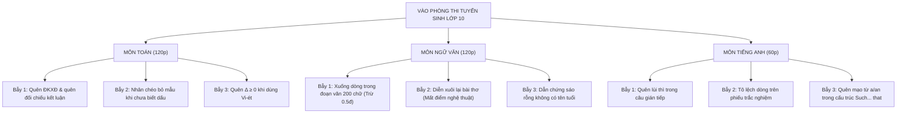

# CẨM NANG PHƯƠNG PHÁP TỰ HỌC TẠI NHÀ & BẢNG BAREM ĐIỂM CHUẨN BỘ GIÁO DỤC
*(Cẩm nang dành riêng cho phụ huynh và học sinh lớp 9 ôn thi vào 10 năm học 2026 - 2027)*

---

> [!IMPORTANT]
> **THÔNG ĐIỆP ĐỒNG HÀNH DÀNH CHO CON TRAI:**
> Kỳ thi vào lớp 10 không phải là cuộc đua xem ai học nhiều giờ hơn, mà là **cuộc so tài về tính kỷ luật, phương pháp học thông minh và khả năng kiểm soát lỗi sai**. Học đúng phương pháp, con hoàn toàn có thể tự học tại nhà đạt từ **8.0 đến 9.0+ điểm cả 3 môn** mà vẫn có thời gian tập thể thao và ngủ đủ giấc!

---

# PHẦN 1: 4 PHƯƠNG PHÁP TỰ HỌC ĐỈNH CAO TẠI NHÀ (KHOA HỌC ĐÃ CHỨNG MINH)

## 1. Phương Pháp Active Recall (Chủ Động Truy Xuất Thông Tin)
* **Sai lầm phổ biến:** Học sinh đọc đi đọc lại sách giáo khoa hoặc xem lại bài giải mẫu rồi tự lừa dối bản thân rằng "mình đã hiểu". Cách học thụ động này khiến kiến thức rơi rụng tới 70% sau 48 giờ.
* **Cách thực hiện chuẩn:**
  1. Sau khi học xong 1 công thức Toán (ví dụ: Hệ thức Vi-ét) hoặc 1 bài thơ Văn, **gấp sách vở lại ngay**.
  2. Lấy một tờ giấy trắng, tự tay viết lại toàn bộ công thức, điều kiện $\Delta \ge 0$, các biểu thức đối xứng hoặc dàn ý luận điểm ra giấy nháp bằng trí nhớ.
  3. Mở sách đối chiếu: Chỗ nào bị quên hoặc viết sai thì dùng bút đỏ khoanh lại. Đó chính là "lỗ hổng kiến thức" thực sự cần bù đắp.

## 2. Phương Pháp Spaced Repetition (Lặp Lại Ngắt Quãng)
* Não bộ con người hoạt động theo *Đường cong quên lãng Ebbinghaus*. Để chuyển kiến thức từ trí nhớ ngắn hạn sang trí nhớ dài hạn (in sâu vào tiềm thức khi đi thi), con cần ôn lại theo chu kỳ 4 mốc thời gian:
  * **Mốc 1 (Sau 24 giờ):** Ôn lại các bài tập đã làm hôm qua trong 10 phút.
  * **Mốc 2 (Sau 3 ngày):** Làm lại 1 bài toán hoặc 1 đề trắc nghiệm tương tự.
  * **Mốc 3 (Sau 1 tuần):** Tự kiểm tra lại bằng bộ tạo đề tự động trên Web App.
  * **Mốc 4 (Sau 1 tháng):** Giải đề tổng hợp trong phòng thi thử chuẩn Sở.

## 3. Kỹ Thuật Feynman (Học Để Giảng Lại Cho Bố Mẹ)
* Bất cứ khi nào con giải xong một bài toán khó (ví dụ: bài toán năng suất chuyển động hoặc bài hình học), bố mẹ hãy đề nghị con: *"Con thử giảng lại cách giải bài này cho bố/mẹ nghe trong 3 phút xem bố/mẹ có hiểu được không?"*.
* Khi con dùng ngôn ngữ đơn giản, mộc mạc để giảng cho bố mẹ hiểu được bản chất bài toán, lúc đó não bộ của con đã thực sự làm chủ kiến thức ở cấp độ chuyên gia.

## 4. Kỹ Thuật "Sổ Tay Lỗi Sai" (Mistake Notebook) - Vũ Khí Tăng Điểm Thần Tốc
* **Sự thật về kỳ thi vào 10:** Học sinh trượt không phải vì không làm được câu khó nhất, mà vì **mắc lại đúng những lỗi sai cũ ở các câu cơ bản**.
* Mỗi khi làm bài thi thử hoặc làm bài tập trên lớp bị chấm sai, con hãy ghi vào mục **Sổ tay lỗi sai** trên Web App theo đúng 3 cột:
  1. *Lỗi sai con đã mắc:* (Ví dụ: Câu 2b quên điều kiện $m > 0$ khi dùng Vi-ét).
  2. *Nguyên nhân:* (Làm vội vàng, không đọc kỹ điều kiện bài toán).
  3. *Cách khắc phục & Bài học:* (Bước 1 phải tính $\Delta$ tìm ĐK có nghiệm trước, bước cuối cùng bắt buộc phải đối chiếu lại ĐK mới được kết luận!).
* **Cam kết vàng:** Mỗi tuần chỉ cần diệt sạch 3 lỗi sai trong sổ tay là điểm thi thử tăng ít nhất **1.0 đến 1.5 điểm**!

---

# PHẦN 2: THỜI GIAN BIỂU TỰ HỌC TẠI NHÀ "KHUNG GIỜ VÀNG" (19h30 – 22h30)

| Khung Giờ | Hoạt Động Cốt Lõi | Mục Tiêu & Nguyên Tắc Thực Hiện |
| :---: | :--- | :--- |
| **19h30 – 19h45** | **Khởi động & Cất điện thoại** | - Dọn bàn học ngăn nắp, chuẩn bị nước uống. - **Quy tắc bất di bất dịch:** Toàn bộ điện thoại, iPad cất ra phòng khách giao bố mẹ giữ. |
| **19h45 – 20h40** *(Ca 1: 50 phút)* | **Môn khó nhất / Môn con sợ nhất** *(Toán Đại số nâng cao hoặc Môn Ngữ văn)* | - Học vào lúc não bộ còn tràn đầy năng lượng nhất sau bữa tối. - Giải quyết bài tập tự luận, viết đoạn văn NLXH theo khung Lego 5 bước. |
| **20h40 – 20h55** | **Giải lao giữa hiệp (15 phút)** | - Đứng dậy vươn vai, hít thở sâu, uống 1 cốc nước ấm, ăn nhẹ quả chuối hoặc sữa hạt. - *Tuyệt đối không xem điện thoại, lướt TikTok/Facebook*. |
| **20h55 – 21h45** *(Ca 2: 50 phút)* | **Môn thực hành & Trắc nghiệm** *(Môn Tiếng Anh hoặc Toán Hình học)* | - Làm 1 đề trắc nghiệm Tiếng Anh (30 - 40 câu) hoặc vẽ hình chứng minh tứ giác nội tiếp. - Bấm giờ nghiêm túc để rèn phản xạ tốc độ. |
| **21h50 – 22h15** *(Ca phụ: 25 phút)* | **Tổng kết ngày & Cập nhật Sổ lỗi sai** | - Ghi chép câu sai vào Sổ tay lỗi sai trên Web App. - Đọc lại 10 từ vựng tiếng Anh hoặc nhẩm lại 1 công thức lượng giác. |
| **22h30** | **Lên giường đi ngủ** | - Đảm bảo ngủ đủ 7 - 8 tiếng mỗi đêm. - *Quy chế sinh học:* Ngủ trước 23h00 là thời điểm não bộ tổng hợp thông tin và sản sinh hoóc-môn tăng trưởng chiều cao cho tuổi 15. |

---

# PHẦN 3: BAREM ĐIỂM CHUẨN CỦA BỘ GIÁO DỤC VÀ ĐÀO TẠO (CHI TIẾT TỪNG 0.25 ĐIỂM)

## 📐 I. MÔN TOÁN HỌC (THỜI GIAN LÀM BÀI: 120 PHÚT)

### 1. Câu Rút Gọn Biểu Thức & Câu Hỏi Phụ (1.5 – 2.0 Điểm)
* **Bước 1 (0.25đ):** Tìm đúng điều kiện xác định của biểu thức (mẫu khác 0, biểu thức trong căn $\ge 0$).
* **Bước 2 (0.25đ):** Phân tích các mẫu thức thành nhân tử, xác định đúng mẫu thức chung.
* **Bước 3 (0.25đ):** Quy đồng mẫu số, giữ nguyên mẫu chung và thực hiện phép nhân phân phối ở tử thức.
* **Bước 4 (0.25đ):** Thu gọn tử thức và rút gọn triệt để với mẫu số ra kết quả tối giản.
* **Bước 5 (0.50đ - Câu hỏi phụ):**
  - Đặt điều kiện đối chiếu với giá trị $x$ đề bài cho (0.25đ).
  - Tính toán chính xác và **viết câu kết luận đầy đủ** (0.25đ - *Quên kết luận bị trừ 0.25đ*).

### 2. Câu Phương Trình Bậc Hai & Định Lý Vi-ét (1.5 Điểm)
* **Bước 1 (0.25đ):** Viết phương trình hoành độ giao điểm hoặc phương trình bậc 2 dạng chính tắc $ax^2 + bx + c = 0$.
* **Bước 2 (0.25đ):** Tính biệt thức $\Delta$ hoặc $\Delta'$, lập luận $\Delta > 0$ và giải ra điều kiện của tham số $m$.
* **Bước 3 (0.25đ):** Viết đúng hệ thức Vi-ét: $S = x_1 + x_2 = -b/a$ và $P = x_1 \cdot x_2 = c/a$.
* **Bước 4 (0.25đ):** Biến đổi biểu thức đối xứng đề bài yêu cầu về dạng chứa $S$ và $P$.
* **Bước 5 (0.25đ):** Thay $S, P$ vào giải ra giá trị của tham số $m$.
* **Bước 6 (0.25đ):** **Đối chiếu giá trị $m$ vừa tìm được với điều kiện ở Bước 2** và kết luận nghiệm (Bắt buộc).

### 3. Bài Toán Thực Tế Lập Phương Trình / Hệ Phương Trình (1.5 Điểm)
* **Bước 1 (0.25đ):** Chọn ẩn số, ghi rõ đơn vị và điều kiện hợp lý của ẩn ($x \in \mathbb{N}^*, x > 0$).
* **Bước 2 (0.50đ):** Biểu diễn các đại lượng chưa biết theo ẩn và các đại lượng đã biết theo đề bài (dự định và thực tế).
* **Bước 3 (0.25đ):** Lập luận để thiết lập phương trình hoặc hệ phương trình bậc nhất hai ẩn.
* **Bước 4 (0.25đ):** Giải chính xác phương trình hoặc hệ phương trình.
* **Bước 5 (0.25đ):** Đối chiếu nghiệm với điều kiện ban đầu, loại nghiệm không thỏa mãn và viết câu trả lời kèm đơn vị.

### 4. Bài Toán Hình Học Phẳng (3.0 Điểm)
* **Vẽ hình (0.25đ):** Vẽ hình chính xác, rõ ràng đến câu a (Vẽ hình sai hoặc không vẽ hình thì giám khảo không chấm toàn bộ bài hình!).
* **Câu a (1.00đ - Chứng minh tứ giác nội tiếp):**
  - Chỉ ra góc vuông thứ nhất $= 90^\circ$ kèm lý do tiếp tuyến hoặc góc nội tiếp chắn nửa đường tròn (0.25đ).
  - Chỉ ra góc vuông thứ hai $= 90^\circ$ kèm lý do (0.25đ).
  - Tính tổng hai góc đối diện $= 180^\circ$ (hoặc hai đỉnh cùng nhìn một cạnh) (0.25đ).
  - Kết luận tứ giác nội tiếp đường tròn (0.25đ).
* **Câu b (1.00đ - Hệ thức tích hoặc tam giác đồng dạng):**
  - Chỉ ra góc chung và cặp góc bằng nhau (do cùng chắn cung hoặc so le trong) (0.50đ).
  - Kết luận hai tam giác đồng dạng theo trường hợp g-g (0.25đ).
  - Suy ra tỉ số đồng dạng và nhân chéo ra hệ thức tích cần chứng minh (0.25đ).
* **Câu c (0.75đ - Phân loại):** Lập luận hình học, tính chất tiếp tuyến hoặc bất đẳng thức hình học để tìm vị trí điểm cực trị.

---

## 📖 II. MÔN NGỮ VĂN (THỜI GIAN LÀM BÀI: 120 PHÚT)

### 1. Phần Đọc - Hiểu Văn Bản (4.0 Điểm)
* **Câu 1 (0.50đ - Nhận biết):** Nêu đúng phương thức biểu đạt chính (hoặc thể thơ, phong cách ngôn ngữ).
* **Câu 2 (0.50đ - Nhận biết):** Trích dẫn đúng, đủ từ ngữ/chi tiết từ văn bản theo yêu cầu "Theo tác giả...".
* **Câu 3 (1.50đ - Biện pháp tu từ - Barem 3 vế):**
  - *Vế 1 (0.50đ):* Gọi đúng tên BPTT + trích dẫn hình ảnh/từ ngữ cụ thể.
  - *Vế 2 (0.50đ):* Nêu tác dụng gợi tả (hình ảnh hiện lên thế nào: sống động, chân thực, kiên cường...).
  - *Vế 3 (0.50đ):* Nêu tác dụng biểu cảm (thái độ, tình cảm của tác giả và cảm xúc khơi gợi nơi người đọc).
* **Câu 4 (1.50đ - Thông điệp & Vận dụng):**
  - Nêu 1 thông điệp tích cực, ý nghĩa nhất (0.50đ).
  - Giải thích ngắn gọn vì sao thông điệp đó đúng đắn và cần thiết (0.50đ).
  - Liên hệ hành động cụ thể, thiết thực của bản thân học sinh lớp 9 (0.50đ).

### 2. Đoạn Văn Nghị Luận Xã Hội 200 Chữ (2.0 Điểm)
* **Yêu cầu hình thức (0.25đ):** Viết đúng 1 đoạn văn từ 20 – 25 dòng, lùi đầu dòng, **tuyệt đối không xuống dòng**.
* **Xác định đúng vấn đề nghị luận (0.25đ):** Nêu trúng tư tưởng đạo lý hoặc hiện tượng đời sống.
* **Triển khai luận điểm (1.00đ):**
  - Giải thích vấn đề là gì (0.25đ).
  - Bàn luận vai trò, ý nghĩa, tính cấp thiết đối với con người và xã hội (0.50đ).
  - Dẫn chứng thực tế xác thực (người thật việc thật: Thầy Nguyễn Ngọc Ký, Ánh Viên, Sài Gòn Xanh...) (0.25đ).
* **Phản đề & Bài học (0.25đ):** Phê phán lối sống tiêu cực, rút ra bài học cho bản thân học sinh lớp 9.
* **Chính tả, ngữ pháp & Sáng tạo (0.25đ):** Diễn đạt lưu loát, dùng từ sáng tạo, có góc nhìn sâu sắc.

### 3. Bài Văn Nghị Luận Văn Học (4.0 Điểm)
* **Mở bài (0.50đ):** Giới thiệu tác giả, tác phẩm, hoàn cảnh sáng tác và trích dẫn yêu cầu của đề bài.
* **Thân bài (2.50đ):**
  - Khái quát bối cảnh / nhân vật trước khi đi vào phân tích (0.50đ).
  - Luận điểm 1: Phân tích vẻ đẹp thứ nhất kèm dẫn chứng thơ/truyện (1.00đ).
  - Luận điểm 2: Phân tích vẻ đẹp thứ hai kèm dẫn chứng phân tích nghệ thuật (0.75đ).
  - Đánh giá đặc sắc nghệ thuật (ngôn từ, hình ảnh, nhịp điệu, tình huống truyện) (0.25đ).
* **Kết bài (0.50đ):** Khẳng định giá trị tác phẩm và bài học nhân sinh sâu sắc.
* **Chính tả, dùng từ & Sáng tạo (0.50đ).**

---

## 📘 III. MÔN TIẾNG ANH (THỜI GIAN LÀM BÀI: 60 PHÚT)

### Phần Tự Luận Viết Lại Câu (Sentence Transformation - 2.0 Điểm)
* Đề thi gồm 4 câu viết lại (mỗi câu 0.50 điểm):
  - **Viết đúng cụm từ biến đổi cấu trúc ngữ pháp:** Đạt **0.25 điểm**.
  - **Viết đúng thì động từ, mạo từ và không sai chính tả phần còn lại:** Đạt **0.25 điểm**.
  - *Lưu ý:* Sai 1 lỗi chính tả hoặc thiếu mạo từ $a/an$ bị trừ 0.25đ; sai thì động từ bị trừ toàn bộ 0.50đ của câu đó.

---

# PHẦN 4: TỔNG HỢP CÁC LỖI THƯỜNG GẶP BỊ TRỪ ĐIỂM OAN & MẸO THẦN TỐC

## Bảng So Sánh Lỗi Sai Và Cách Xử Lý Điểm Tuyệt Đối
| Môn | Hành Vi Làm Bài Mất Điểm Oan | Cách Xử Lý Chuẩn Để Ăn Trọn Điểm Barem |
| :--- | :--- | :--- |
| **Toán** | Giải ra $x = 10, x = -12$ trong bài toán thực tế rồi ghi luôn: "Vậy đội có 10 xe và -12 xe". | Ghi rõ: $x = 10$ (thỏa mãn ĐK); $x = -12$ (loại vì số xe phải là số nguyên dương). Kết luận: Vậy đội có 10 xe. |
| **Toán** | Áp dụng Vi-ét $x_1 + x_2 = 2m$ khi chưa tính $\Delta$. | Bắt buộc tính $\Delta$, giải bất phương trình $\Delta \ge 0$ ra khoảng nghiệm của $m$, sau đó mới viết: "Với $m \ge \dots$ áp dụng hệ thức Vi-ét...". |
| **Văn** | Viết đoạn văn NLXH chia thành 3 đoạn: Mở đoạn, Thân đoạn, Kết đoạn xuống dòng 2 lần. | Viết liền một khối văn bản duy nhất từ 20 đến 25 dòng, chữ cái đầu tiên lùi vào 1 ô và viết hoa, chấm hết đoạn ở cuối cùng. |
| **Văn** | Đọc hiểu hỏi "Tác giả thể hiện thái độ gì?", học sinh chép lại cả đoạn văn dài 10 dòng. | Trả lời ngắn gọn gãy gọn trong 1 câu: "Thái độ của tác giả là sự trân trọng, ngợi ca và niềm tin yêu sâu sắc đối với người lao động". |
| **Anh** | Chuyển câu trực tiếp: *"I am doing homework," Nam said.* ➔ *Nam said that he is doing homework.* | Bắt buộc phải lùi thì: *Nam said that he **was doing** his homework.* |
| **Anh** | Làm xong câu nào không tô ngay, để cuối giờ mới tô vội vàng dẫn đến tô lệch dòng 5 - 10 câu. | Làm xong trang nào tô ngay phiếu trả lời trang đó. Luôn dùng ngón tay trái chỉ vào câu trong đề và tay phải tô vào đúng số câu trên phiếu. |

---

# PHẦN 5: LỜI KHUYÊN DÀNH CHO PHỤ HUYNH TRONG GIAI ĐOẠN NƯỚC RÚT

1. **Giữ vững tâm lý "Bình tĩnh là sức mạnh":**
   - Tâm lý của con trai tuổi 15 thường nhạy cảm, dễ chán nản nếu bị so sánh với "con nhà người ta". Bố mẹ hãy luôn là chỗ dựa bình yên, động viên bằng những lời tích cực: *"Bố mẹ tin con đang tiến bộ từng ngày!"*.
2. **Đầu tư dinh dưỡng cho bộ não:**
   - Bữa sáng là bữa ăn quan trọng nhất: Cung cấp trứng gà, bánh mì nguyên cám, sữa chua, chuối chín.
   - Bữa tối: Ăn trước 19h00, thức ăn thanh đạm, nhiều rau xanh và cá hồi/cá thu giàu Omega-3, hạn chế đồ chiên rán cay nóng gây buồn ngủ khi ngồi học.
3. **Đồng hành giám sát mà không soi mói:**
   - Hàng tuần cùng con mở mục **Tiến trình học tập (Dashboard)** trên Web App để xem con đã hoàn thành bao nhiêu ca Pomodoro và số lỗi sai đã được khắc phục. Khen thưởng kịp thời một buổi xem phim hoặc một trận bóng rổ cuối tuần khi con đạt mục tiêu tuần!

---
*Tài liệu được biên soạn đồng bộ với hệ thống Web App ôn thi vào 10 THPT Trần Phú & THPT Đoan Hùng 2026-2027.*
