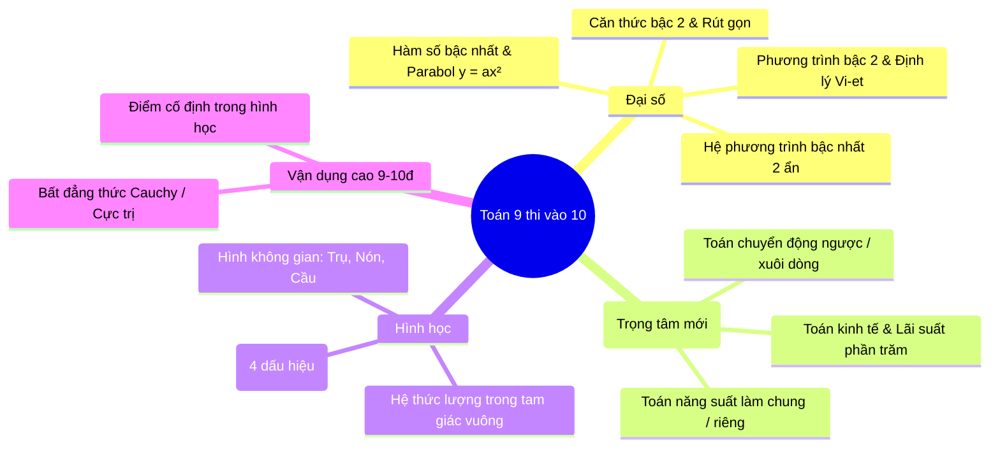
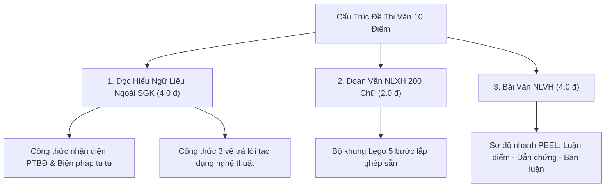

# CẨM NANG ÔN TẬP TOÁN & NGỮ VĂN DÀNH CHO CON THI VÀO 10 (2026 - 2027)
### TRỌNG TÂM 2 MÔN BẮT BUỘC THEO ĐỊNH HƯỚNG MỚI CỦA BỘ GD&ĐT
### MỤC TIÊU: THI ĐỖ TRƯỜNG THPT TRẦN PHÚ (VĨNH YÊN) • ĐIỂM SỐ: TOÁN 8.5+ | VĂN 7.5+

---

## PHẦN 1: BỐI CẢNH MỚI 2026 - 2027 & CHIẾN LƯỢC TẬP TRUNG TOÁN - VĂN

Theo dự thảo quy chế tuyển sinh vào lớp 10 THPT công lập mới nhất của Bộ Giáo dục & Đào tạo áp dụng cho chương trình GDPT 2018:
1. **Toán và Ngữ văn là 2 môn thi BẮT BUỘC và CỐ ĐỊNH** trên toàn quốc (chiếm từ 70% - 100% trọng số xét tuyển tùy từng tỉnh thành).
2. **Đặc thù đề thi mới:**
   - **Môn Toán:** Tăng mạnh các bài toán ứng dụng thực tế (kinh tế, năng suất, chuyển động, hình học không gian đời sống) và kết hợp trắc nghiệm khách quan với tự luận.
   - **Môn Ngữ văn:** 100% sử dụng ngữ liệu **ĐỌC HIỂU và NGHỊ LUẬN ngoài Sách giáo khoa**. Không còn tình trạng học tủ văn mẫu hay chép lại tác phẩm đã học trên lớp.
3. **Chiến lược "trị lười" cho con trai:** Chuyển từ cách học nhồi nhét, đọc chép truyền thống sang **"Học theo Mô hình - Công thức Logic - Thực hành tương tác trên web"**.

---

## PHẦN 2: TỔNG HỢP KIẾN THỨC CỐT LÕI TỪ CƠ BẢN ĐẾN NÂNG CAO MÔN TOÁN

### 1. Chuyên đề 1: Căn Thức Bậc Hai & Bài Toán Rút Gọn
* **Mức cơ bản (5.0 - 6.0 điểm):**
  - Điều kiện xác định: $\sqrt{A}$ có nghĩa $\Leftrightarrow A \ge 0$; $\frac{1}{A}$ có nghĩa $\Leftrightarrow A \ne 0$.
  - 3 phép biến đổi nền tảng: Đưa thừa số ra ngoài/vào trong dấu căn, trục căn thức ở mẫu, quy đồng mẫu thức.
* **Mức khá & nâng cao (7.0 - 8.5+ điểm):**
  - **Dạng 1: Tìm $x$ để biểu thức $P \in \mathbb{Z}$:** Thực hiện phép chia đa thức lấy Tử chia Mẫu: $P = \text{Phần nguyên} + \frac{\text{Hằng số}}{\text{Mẫu}}$. Để $P \in \mathbb{Z}$ thì Mẫu phải là ước của Hằng số.
  - **Dạng 2: So sánh $P$ với số $m$ hoặc tìm $x$ để $P > m$:** Luôn xét hiệu $P - m$, quy đồng chuyển vế và xét dấu tử/mẫu (tuyệt đối không nhân chéo bỏ mẫu khi chưa biết dấu).
* **Mẹo bấm máy tính Casio 580VNX / 880BTG:**
  - Nhập biểu thức $P$ vào máy ➔ Bấm phím `CALC` ➔ Nhập các giá trị $x = 4, 9, 16, 25$ để kiểm tra lại kết quả rút gọn có đúng hay không trong 10 giây.

---

### 2. Chuyên đề 2: Phương Trình Bậc Hai & Định Lý Vi-ét Có Tham Số $m$
* **Mức cơ bản:**
  - Giải phương trình $ax^2 + bx + c = 0$ bằng công thức biệt thức $\Delta = b^2 - 4ac$ (hoặc $\Delta' = b'^2 - ac$).
  - Nhẩm nghiệm nhanh: Nếu $a + b + c = 0 \Rightarrow x_1 = 1, x_2 = \frac{c}{a}$. Nếu $a - b + c = 0 \Rightarrow x_1 = -1, x_2 = -\frac{c}{a}$.
* **Mức nâng cao (Dạng câu hỏi phân loại 8.5+ trong đề thi Vĩnh Phúc):**
  - **Quy trình 3 bước vàng không bao giờ bị trừ điểm:**
    * *Bước 1:* Tính $\Delta$ và đặt điều kiện để phương trình có 2 nghiệm phân biệt ($\Delta > 0$). (Đây là bẫy học sinh lười hay bỏ qua nhất dẫn tới mất 0.5 điểm!).
    * *Bước 2:* Viết hệ thức Vi-ét: $S = x_1 + x_2 = -\frac{b}{a}$, $P = x_1 x_2 = \frac{c}{a}$.
    * *Bước 3:* Biến đổi biểu thức đề bài theo $S$ và $P$:
      + $x_1^2 + x_2^2 = (x_1 + x_2)^2 - 2x_1 x_2 = S^2 - 2P$
      + $\frac{1}{x_1} + \frac{1}{x_2} = \frac{x_1 + x_2}{x_1 x_2} = \frac{S}{P}$
      + $|x_1 - x_2| = \sqrt{(x_1 - x_2)^2} = \sqrt{S^2 - 4P}$
      + Biểu thức không đối xứng (Ví dụ: $x_1 = 2x_2$): Kết hợp $x_1 - 2x_2 = 0$ với tổng $x_1 + x_2 = S$ giải hệ tìm ra $x_1, x_2$ theo $m$ rồi thay vào tích $P$.
    * *Bước 4:* Giải ra $m$ và **đối chiếu với điều kiện ở Bước 1** để kết luận.

---

### 3. Chuyên đề 3: Toán Thực Tế (Chiếm 1.5 - 2.0 Điểm Trong Đề Thi Mới)
* **Toán Chuyển Động:**
  - Nhớ thần chú: $S = v \times t$.
  - Xuôi dòng: $v_{\text{xuôi}} = v_{\text{thực}} + v_{\text{nước}}$. Ngược dòng: $v_{\text{ngược}} = v_{\text{thực}} - v_{\text{nước}}$.
* **Toán Năng Suất (Làm chung - Làm riêng):**
  - Quy ước toàn bộ công việc hoàn thành là $1$.
  - Năng suất trong 1 ngày/giờ = $\frac{1}{\text{Thời gian hoàn thành một mình}}$.
* **Toán Kinh Tế & Chiết Khấu Phần Trăm:**
  - Mua hàng giảm giá $k\%$: Giá mới = Giá ban đầu $\times \left(1 - \frac{k}{100}\right)$.
  - Tăng giá $k\%$: Giá mới = Giá ban đầu $\times \left(1 + \frac{k}{100}\right)$.

---

### 4. Chuyên đề 4: Tứ Giác Nội Tiếp & Hình Học Không Gian Thực Tế
* **4 Cách Chứng Minh Tứ Giác Nội Tiếp (Khắc cốt ghi tâm):**
  1. *Cách 1 (80% đề thi ra):* Tổng hai góc đối nhau bằng $180^\circ$ (Ví dụ: $\widehat{A} + \widehat{C} = 180^\circ$).
  2. *Cách 2:* Hai đỉnh kề nhau cùng nhìn một cạnh chứa hai đỉnh còn lại dưới các góc bằng nhau (Ví dụ: $\widehat{DAC} = \widehat{DBC}$).
  3. *Cách 3:* Góc ngoài tại một đỉnh bằng góc trong tại đỉnh đối diện.
  4. *Cách 4:* Bốn đỉnh cùng cách đều một điểm cố định (Tâm đường tròn).
* **Công thức hình không gian thực tiễn:**
  - **Hình trụ:** Thể tích $V = \pi r^2 h$; Diện tích xung quanh $S_{xq} = 2\pi r h$.
  - **Hình nón:** Thể tích $V = \frac{1}{3}\pi r^2 h$; Diện tích xung quanh $S_{xq} = \pi r l$ ($l$ là đường sinh: $l = \sqrt{r^2 + h^2}$).
  - **Hình cầu:** Thể tích $V = \frac{4}{3}\pi R^3$; Diện tích mặt cầu $S = 4\pi R^2$.

---

## PHẦN 3: TỔNG HỢP KIẾN THỨC CỐT LÕI MÔN NGỮ VĂN (TỪ 4 LÊN 7.5+)

Dành riêng cho con trai lười học văn: **Học Văn bằng công thức toán học và tư duy logic, không cần đọc chép văn mẫu!**

### 1. Bí Quyết Lấy Trọn 4.0 Điểm Đọc - Hiểu Ngữ Liệu Ngoài SGK
* **Bảng thần chú nhận diện nhanh Phương thức biểu đạt (PTBĐ):**
  - Có cốt truyện, chuỗi sự việc, nhân vật $\rightarrow$ **Tự sự**.
  - Tả cảnh sắc, chân dung, âm thanh, hình khối $\rightarrow$ **Miêu tả**.
  - Bộc lộ cảm xúc yêu thương, đau xót, vui sướng, thơ ca $\rightarrow$ **Biểu cảm**.
  - Bàn luận, đưa ra quan điểm, lý lẽ, dẫn chứng thuyết phục $\rightarrow$ **Nghị luận**.
  - Giới thiệu tri thức khoa học, quy trình, số liệu khách quan $\rightarrow$ **Thuyết minh**.
* **Công thức 3 vế trả lời tác dụng của Biện pháp tu từ:**
  $$\text{Tác dụng} = \text{Tăng sức gợi hình/gợi cảm} + \text{Làm nổi bật nội dung/hình ảnh X} + \text{Bộc lộ thái độ/tình cảm của tác giả Y}$$

---

### 2. Bộ Khung Lắp Ghép Lego Đoạn Văn NLXH 200 Chữ (Ăn Trọn 1.75 - 2.0 Điểm)
Độ dài chuẩn: **20 - 25 dòng giấy thi (tuyệt đối không xuống dòng tách đoạn)**.

| Bước | Nhiệm vụ | Mẫu câu lắp ráp dùng cho mọi đề bài |
| :--- | :--- | :--- |
| **1. Mở đoạn** | Dẫn dắt & Nêu vấn đề (1-2 câu) | *"Trong hành trình hoàn thiện nhân cách để vươn tới thành công, [Vấn đề X: lòng kiên trì / tinh thần tự học / lòng biết ơn...] chính là một trong những hành trang quý báu nhất của mỗi con người."* |
| **2. Giải thích** | Bản chất vấn đề là gì? (1-2 câu) | *"[Vấn đề X] có thể hiểu là [thái độ sống tích cực / nỗ lực bền bỉ không bỏ cuộc], giúp chúng ta có đủ bản lĩnh vượt qua mọi sóng gió."* |
| **3. Bàn luận** | Vì sao cần có? Giá trị là gì? (4-5 câu) | *"Thật vậy, người có [Vấn đề X] sẽ luôn giữ vững niềm tin, không chùn bước trước thất bại và tạo dựng được uy tín trong xã hội. Không chỉ giúp bản thân tiến bộ mỗi ngày, [Vấn đề X] còn lan tỏa nguồn năng lượng tích cực đến cộng đồng xung quanh."* |
| **4. Dẫn chứng** | 1 tấm gương thực tế cụ thể (2-3 câu) | *"Minh chứng tiêu biểu là [Tên tấm gương: Thầy giáo Nguyễn Ngọc Ký / VĐV Ánh Viên / Nhà sáng chế Thomas Edison] - người đã [vượt qua khó khăn cụ thể] để [đạt được thành tựu xuất sắc], trở thành tấm gương sáng cho hàng triệu người."* |
| **5. Phản đề & Bài học** | Phê phán lối sống ngược lại + Liên hệ bản thân (2-3 câu) | *"Đáng buồn thay, trong xã hội vẫn còn những bạn trẻ sống ỷ lại, lười biếng và thiếu [Vấn đề X], đó là lối sống đáng bị phê phán. Đứng trước kỳ thi vào lớp 10 đầy thử thách, em tự nhắc nhở bản thân cần rèn luyện [Vấn đề X] ngay từ việc tự giác học tập mỗi ngày."* |

---

### 3. Bộ 5 Tấm Gương Thực Tế "Dùng Cho Mọi Đề Văn Nghị Luận Xã Hội"
1. **Lòng kiên trì / Vượt nghịch cảnh:** *Thầy giáo Nguyễn Ngọc Ký* (bị liệt cả 2 tay từ nhỏ nhưng kiên trì luyện viết bằng chân để trở thành nhà giáo ưu tú).
2. **Ước mơ / Nghị lực phi thường:** *Nick Vujicic* (người đàn ông không tay, không chân nhưng chu du khắp thế giới truyền cảm hứng sống cho hàng triệu người).
3. **Đổi mới sáng tạo / Dám nghĩ dám làm:** *Steve Jobs* (bị sa thải khỏi chính công ty Apple do mình sáng lập nhưng kiên định làm lại từ đầu để thay đổi nền công nghệ toàn cầu).
4. **Tinh thần sẻ chia / Lòng nhân ái:** *Hoạt động cứu trợ đồng bào vùng bão lũ của nhân dân cả nước* (tinh thần tương thân tương ái "lá lành đùm lá rách" của dân tộc Việt Nam).
5. **Ý thức trách nhiệm của tuổi trẻ:** *Hình ảnh các bạn thanh niên tình nguyện tham gia tiếp sức mùa thi, bảo vệ môi trường biển*.

---

## PHẦN 4: TOP NGUỒN TÀI LIỆU & KÊNH BÀI GIẢNG ONLINE HAY NHẤT DÀNH CHO CON

Dành riêng cho học sinh ngại đọc sách dày, thích xem video giải thích trực quan:

### 1. Kênh Học Toán Trực Quan, Cuốn Hút (Miễn phí trên YouTube)
* **Kênh "Thầy Quang" (Toán thầy Quang):** Phong cách giảng dạy dí dỏm, thực tế, đặc biệt chuyên trị học sinh mất gốc và học sinh trung bình. Thầy giải thích từng bước giải phương trình và hình học cực kỳ dễ hiểu.
* **Kênh "Thầy Nguyễn Quốc Chí":** Chuyên sâu mẹo giải nhanh toán 9 thi vào 10, cách dùng máy tính Casio loại trừ đáp án trắc nghiệm trong 15 giây.
* **Kênh "Tuyensinh247" & "Hocmai THCS":** Hệ thống bài giảng chuẩn cấu trúc đề thi các tỉnh thành (có riêng chuyên đề đề thi Vĩnh Phúc, Phú Thọ, Hà Nội).

### 2. Kênh Học Văn Bằng Sơ Đồ Tư Duy & Logic
* **Kênh "Học Văn Cô Sương Mai":** Hướng dẫn phương pháp viết đoạn văn NLXH và đọc hiểu ngữ liệu ngoài SGK cực kỳ bài bản, tư duy hiện đại, không dạy sáo rỗng.
* **Kênh "Thầy Nhật Dạy Văn":** Dạy văn bằng **Mindmap (Sơ đồ tư duy)**, tóm gọn luận điểm tác phẩm thành các từ khóa ngắn, giúp con trai dễ nhớ và không bị ngấy chữ.
* **Trang web Hocmai.vn / VietJack.com:** Tra cứu nhanh dàn ý chi tiết và ngữ pháp Tiếng Việt (các biện pháp tu từ, câu ghép, thành phần biệt lập).

---

## PHẦN 5: LỊCH HỌC TỐI ƯU HÓA CHO 2 MÔN TOÁN & VĂN (KÈM NGHỈ NGƠI)

| Khung giờ | Thứ 2 | Thứ 3 | Thứ 4 | Thứ 5 | Thứ 6 | Thứ 7 | Chủ Nhật |
| :--- | :--- | :--- | :--- | :--- | :--- | :--- | :--- |
| **Tối (19h45 - 20h40)** | **TOÁN Đại số** | **VĂN Đọc hiểu** | **TOÁN Thực tế** | **VĂN NLXH 200 chữ** | **TOÁN Hình học** | **CHIỀU:** Đề Toán (60p) + Thể thao | **SÁNG:** Thi thử Toán (120p) |
| **Nghỉ (20h40 - 20h55)** | *Giải lao 15p* | *Giải lao 15p* | *Giải lao 15p* | *Giải lao 15p* | *Giải lao 15p* | *Nghỉ ngơi, ăn tối* | *Nghỉ trưa, thư giãn* |
| **Tối (20h55 - 21h45)** | **VĂN Công thức** | **TOÁN Vi-ét** | **VĂN Dàn ý bài** | **TOÁN Hình học** | **Xử lý BTVN** | **TỐI:** Xem chữa bài | **CHIỀU:** Thi thử Văn (120p) |
| **Chốt (21h50 - 22h15)** | Ôn lỗi sai | Làm 5 câu trắc nghiệm | Đọc 1 bài báo hay | Xem lại công thức | Kế hoạch cuối tuần | Thư giãn / Game | **TỐI:** Tổng kết tuần |

---
*Cẩm nang này được thiết kế để in ra giấy A4 hoặc mở trực tiếp trên website luyện đề để con tra cứu hàng ngày.*
