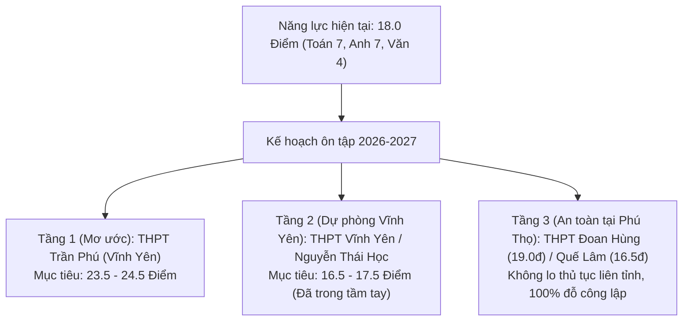

# BÁO CÁO THÔNG TIN TUYỂN SINH VÀO LỚP 10 THPT (NĂM HỌC 2026 - 2027)
## KHU VỰC HUYỆN ĐOAN HÙNG (PHÚ THỌ) VÀ THÀNH PHỐ VĨNH YÊN (VĨNH PHÚC)
### PHÂN TÍCH ĐIỂM CHUẨN, CHỈ TIÊU & CHIẾN LƯỢC ĐẶT NGUYỆN VỌNG THÔNG MINH

---

## PHẦN I: THÔNG TIN TUYỂN SINH CÁC TRƯỜNG THPT HUYỆN ĐOAN HÙNG (PHÚ THỌ)

Học sinh có hộ khẩu và theo học cấp THCS tại huyện Đoan Hùng (tỉnh Phú Thọ) có quyền lợi đăng ký dự thi trực tiếp vào các trường THPT công lập trên địa bàn huyện theo tuyến tuyển sinh của Sở GD&ĐT tỉnh Phú Thọ.

### 1. Bảng Tổng Hợp Điểm Chuẩn & Chỉ Tiêu Tuyển Sinh 3 Năm Gần Nhất

| Tên trường THPT | Địa chỉ / Khu vực | Chỉ tiêu hàng năm | Điểm chuẩn 2026 | Điểm chuẩn 2025 | Điểm chuẩn 2024 | Điểm TB/môn (2026) |
| :--- | :--- | :---: | :---: | :---: | :---: | :---: |
| **THPT Đoan Hùng** | Thị trấn Đoan Hùng | ~420 - 450 HS | **19.00** | 16.50 | 18.20 | **6.33 đ/môn** |
| **THPT Quế Lâm** | Xã Hùng Long, Đoan Hùng | ~360 - 380 HS | **16.50** | 14.50 | 15.35 | **5.50 đ/môn** |
| **THPT Chân Mộng** | Xã Chân Mộng, Đoan Hùng | ~320 - 350 HS | **15.75** | 14.25 | 16.15 | **5.25 đ/môn** |

*(Ghi chú: Điểm xét tuyển là tổng điểm 3 bài thi Toán, Ngữ văn, Tiếng Anh tính hệ số 1 cộng điểm ưu tiên nếu có).*

### 2. Đánh Giá Từng Trường Tại Đoan Hùng

* **Trường THPT Đoan Hùng (Trường Top 1 của huyện):**
  * *Vị trí:* Trung tâm thị trấn Đoan Hùng, giao thông đi lại thuận tiện.
  * *Chất lượng:* Đội ngũ giáo viên giàu kinh nghiệm, tỷ lệ đỗ đại học cao nhất huyện. Hằng năm điểm chuẩn dao động từ 16.5 đến 19.0 điểm.
  * *Đánh giá với con trai:* Hiện tại điểm khảo sát của con là **18.0 điểm** (Toán 7, Anh 7, Văn 4). Con chỉ cần kéo môn Văn từ 4.0 lên **5.5 - 6.0 điểm** (hoàn toàn trong tầm tay nhờ công thức đọc hiểu và đoạn văn barem) là **chắc chắn đỗ THPT Đoan Hùng** với tổng điểm từ 19.5 - 20.5 điểm!
* **Trường THPT Quế Lâm (Phương án dự phòng vừa sức):**
  * *Chất lượng:* Môi trường nền nếp, mức độ cạnh tranh vừa phải. Điểm chuẩn năm 2026 là **16.50 điểm**.
  * *Đánh giá với con trai:* Điểm hiện tại của con (18.0) đã **thừa 1.5 điểm** so với điểm chuẩn năm 2026.
* **Trường THPT Chân Mộng (Phương án an toàn tuyệt đối):**
  * *Vị trí:* Nằm ở phía nam huyện Đoan Hùng, giáp huyện Phù Ninh.
  * *Điểm chuẩn:* Ổn định ở mức **14.25 - 16.15 điểm**. Đây là ngưỡng điểm an toàn 100% cho con.

---

## PHẦN II: THÔNG TIN TUYỂN SINH CÁC TRƯỜNG THPT TP. VĨNH YÊN (VĨNH PHÚC)

Thành phố Vĩnh Yên là trung tâm chính trị, văn hóa, giáo dục của tỉnh Vĩnh Phúc. Sở GD&ĐT Vĩnh Phúc hằng năm quy định **mức điểm sàn riêng cho khu vực TP. Vĩnh Yên (năm 2025 là 15.50 điểm)**.

### 1. Bảng Tổng Hợp Điểm Chuẩn & Chỉ Tiêu Tuyển Sinh Tại TP. Vĩnh Yên

| Tên trường THPT | Địa bàn phường / xã | Chỉ tiêu hàng năm | Điểm chuẩn 2025-2026 (Hệ số 1) | Điểm chuẩn các năm trước (Hệ số 2) | Phân tầng chất lượng |
| :--- | :--- | :---: | :---: | :---: | :---: |
| **THPT Trần Phú** | P. Liên Bảo, TP. Vĩnh Yên | 480 - 500 HS (11 lớp) | **22.50 điểm** | 33.25 (2024) • 35.50 (2023) | **Top 1 Công lập Vĩnh Yên** |
| **THPT Vĩnh Yên** | P. Đống Đa, TP. Vĩnh Yên | 400 - 450 HS (10 lớp) | **16.50 điểm** | 28.00 (2023) | **Top 2 Công lập Vĩnh Yên** |
| **THPT Nguyễn Thái Học** | P. Khai Quang, TP. Vĩnh Yên | 380 - 400 HS (9 lớp) | **16.25 điểm** | 30.83 (2023) | **Vừa sức tại Vĩnh Yên** |
| **THPT Kim Ngọc** | Xã Kim Long / TP. Vĩnh Yên | 320 - 350 HS (8 lớp) | **15.50 điểm** (Điểm sàn) | 28.00 (2023) | **An toàn tại Vĩnh Yên** |
| **THPT Chuyên Vĩnh Phúc** | Xã Định Trung, TP. Vĩnh Yên | ~500 HS (15 lớp chuyên) | *Thi tuyển đề riêng* | *Thi tuyển đề riêng* | **Trường Chuyên số 1 tỉnh** |

### 2. Đánh Giá Chi Tiết Các Trường Tại TP. Vĩnh Yên

* **Trường THPT Trần Phú (Mục tiêu số 1 của gia đình):**
  * *Vị thế:* Trường THPT không chuyên có truyền thống và điểm đầu vào cao nhất thành phố Vĩnh Yên.
  * *Tỷ lệ chọi:* Khoảng 1 chọi 1.8 đến 1 chọi 2.2. Điểm chuẩn tính hệ số 1 là **22.50 điểm** (trung bình 7.5 điểm/môn).
  * *Mục tiêu cần đạt cho con:* **Toán ≥ 8.5, Văn ≥ 7.0 - 7.5, Môn 3 ≥ 8.0 ➔ Tổng điểm ≥ 23.5 - 24.5 điểm**.
* **Trường THPT Vĩnh Yên (Phao cứu sinh xuất sắc tại Vĩnh Yên):**
  * *Vị thế:* Trường công lập lâu năm của thành phố, chất lượng dạy học tốt, cơ sở vật chất khang trang.
  * *Điểm chuẩn:* Năm gần nhất chỉ lấy **16.50 điểm** (trung bình 5.5 điểm/môn).
  * *Đánh giá với con trai:* Điểm khảo sát của con (18.0) **đã vượt điểm chuẩn trường THPT Vĩnh Yên 1.5 điểm**! Nếu gia đình muốn con học cấp 3 tại TP. Vĩnh Yên mà không phải chịu áp lực thi cử quá nặng, THPT Vĩnh Yên là lựa chọn cực kỳ sáng suốt và an toàn.
* **Trường THPT Nguyễn Thái Học:**
  * Điểm chuẩn **16.25 điểm**, tương đương THPT Vĩnh Yên. Môi trường năng động, phong trào học tập tốt.
* **Trường THPT Kim Ngọc:**
  * Trường mới xây dựng đạt chuẩn quốc gia, sĩ số lớp học vừa phải, điểm chuẩn bám sát sàn 15.50 điểm.

---

## PHẦN III: SO SÁNH GIỮA 2 PHƯƠNG ÁN: THI TẠI VĨNH YÊN HAY ĐOAN HÙNG?

| Tiêu chí so sánh | Phương án 1: Thi vào TP. Vĩnh Yên (Vĩnh Phúc) | Phương án 2: Thi tại Huyện Đoan Hùng (Phú Thọ) |
| :--- | :--- | :--- |
| **Trường mục tiêu chính** | **THPT Trần Phú** (Top 1) | **THPT Đoan Hùng** (Top 1 huyện) |
| **Mức độ cạnh tranh** | Rất cao (Điểm chuẩn ≥ 22.50) | Vừa phải (Điểm chuẩn ~19.00) |
| **Trường dự phòng cùng khu vực** | THPT Vĩnh Yên (16.50đ) / Nguyễn Thái Học (16.25đ) | THPT Quế Lâm (16.50đ) / Chân Mộng (15.75đ) |
| **Thủ tục đăng ký dự thi** | Cần giấy xác nhận chuyển tuyến ngoại tỉnh hoặc đăng ký tạm trú tại Vĩnh Phúc theo hướng dẫn Sở GD&ĐT Vĩnh Phúc tháng 3 | Hoàn toàn thuận lợi, đăng ký trực tuyến theo mã định danh trường THCS đang học tại Đoan Hùng |
| **Môi trường sinh hoạt** | Môi trường đô thị phát triển, nhiều trung tâm luyện thi đại học | Gần gia đình, tiết kiệm chi phí đi lại và trọ học |
| **Yêu cầu phong độ của con** | Phải tăng tốc mạnh mẽ cả Toán (8.5+) và Văn (7.5+) | Điểm hiện tại (18.0) chỉ cần tăng nhẹ môn Văn lên 5.5 là đỗ chắc |

---

## PHẦN IV: CHIẾN LƯỢC ĐẶT NGUYỆN VỌNG 3 TẦNG "BẢO VỆ TUYỆT ĐỐI"

Dựa trên dữ liệu thực tế và tính cách của bạn nam lớp 9 (ngại học lý thuyết, học lực hiện tại: Toán 7, Anh 7, Văn 4), lộ trình đặt nguyện vọng an toàn nhất như sau:

### Lời Khuyên Dành Cho Phụ Huynh:
1. **Trước Tết (Tháng 11 - 12):** Lấy mục tiêu **THPT Trần Phú** làm động lực cao nhất để thúc đẩy con thoát khỏi vùng an toàn. Dạy con học theo công thức Lego môn Văn và mẹo Casio môn Toán.
2. **Sau Tết (Tháng 3):** Dựa vào kết quả thi khảo sát Học kỳ 1 của con:
   * Nếu tổng điểm đạt **≥ 21.0 điểm**: Tự tin nộp hồ sơ thi vào **THPT Trần Phú (Vĩnh Yên)**.
   * Nếu tổng điểm dao động **17.0 - 19.5 điểm**: Gia đình có 2 lựa chọn cực kỳ đẹp: Đăng ký **THPT Vĩnh Yên** (nếu muốn học ở thành phố) hoặc đăng ký **THPT Đoan Hùng** (học tại huyện nhà).
3. Với chiến lược này, con trai anh vừa có mục tiêu cao để phấn đấu, vừa có "lưới bảo hiểm an toàn" đảm bảo **100% đỗ trường cấp 3 công lập chất lượng cao** mà không bao giờ rơi vào cảnh trượt cấp 3!
