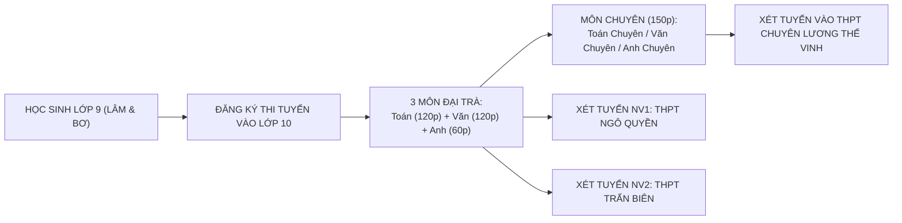

# THÔNG TIN TUYỂN SINH VÀO LỚP 10 TỈNH ĐỒNG NAI (2026 - 2027)
## HỒ SƠ THPT CHUYÊN LƯƠNG THẾ VINH, THPT NGÔ QUYỀN, THPT TRẤN BIÊN & CHIẾN LƯỢC SONG MÃ CHO LÂM & BƠ

---

> [!IMPORTANT]
> **THÔNG ĐIỆP ĐẶC BIỆT DÀNH CHO HAI CHỊ EM (LÂM & BƠ):**
> Đồng Nai là một trong những tỉnh có quy mô giáo dục lớn và chất lượng hàng đầu khu vực phía Nam. Cánh cổng **THPT Chuyên Lương Thế Vinh** và các trường công lập danh tiếng như **THPT Ngô Quyền**, **THPT Trấn Biên** luôn mở rộng chào đón những học sinh có ý chí tự học, bản lĩnh và kỷ luật. Hai chị em hãy cùng nhau so tài, học hỏi lẫn nhau để cùng tiến bộ mỗi ngày!

---

# PHẦN 1: TỔNG QUAN PHƯƠNG THỨC TUYỂN SINH VÀO LỚP 10 SỞ GD&ĐT ĐỒNG NAI

## 1. Phương Thức Thi Tuyển & Môn Thi
* **Hình thức tuyển sinh:** Thi tuyển kết hợp xét tuyển học bạ THCS theo quy định của Sở Giáo dục và Đào tạo tỉnh Đồng Nai.
* **3 Môn thi đại trà:**
  1. **Môn Toán:** Thời gian làm bài 120 phút (Hình thức: Tự luận hoặc Tự luận kết hợp trắc nghiệm khách quan).
  2. **Môn Ngữ văn:** Thời gian làm bài 120 phút (Đọc hiểu văn bản ngoài SGK + Đoạn văn NLXH 200 chữ + Bài văn Nghị luận văn học).
  3. **Môn Tiếng Anh:** Thời gian làm bài 60 phút (Trắc nghiệm khách quan kết hợp tự luận viết lại câu).
* **Môn chuyên (dành cho thí sinh thi THPT Chuyên Lương Thế Vinh):**
  - Thí sinh thi thêm môn chuyên tương ứng với lớp chuyên đăng ký (Toán chuyên, Tin học, Ngữ văn chuyên, Tiếng Anh chuyên, Vật lý chuyên, Hóa học chuyên, Sinh học chuyên).
  - Thời gian làm bài môn chuyên: **150 phút**.

## 2. Đặc Trưng Đề Thi Tuyển Sinh Vào 10 Của Tỉnh Đồng Nai
* **Môn Toán Đồng Nai:** Thường có 5 bài toán tự luận, nổi bật với các bài toán ứng dụng thực tế đời sống phương Nam (chuyển động xe máy, bồn chứa nước, năng suất sản xuất, phần trăm giảm giá). Đề thi có tính phân loại cao ở câu hình học phẳng và câu bất đẳng thức cực trị.
* **Môn Ngữ Văn Đồng Nai:** Rất chú trọng ngữ liệu Đọc hiểu ngoài SGK mang tính nhân văn, hướng về gia đình, quê hương Nam Bộ hào sảng và tinh thần tự lập của thế hệ trẻ.
* **Môn Tiếng Anh Đồng Nai:** Khảo sát toàn diện ngữ âm, trọng âm, 6 thì cơ bản, viết lại câu và các cụm động từ quen thuộc trong đời sống.

---

# PHẦN 2: BẢNG TRA CỨU ĐIỂM CHUẨN & CHỈ TIÊU CÁC TRƯỜNG TOP ĐẦU ĐỒNG NAI

| Tên Trường THPT | Địa Bàn | Điểm Chuẩn Tuyển Sinh (Gần Nhất) | Chỉ Tiêu Tuyển Sinh | Đánh Giá & Định Vị |
| :--- | :--- | :---: | :---: | :--- |
| **THPT Chuyên Lương Thế Vinh** | P. Tân Hiệp, TP. Biên Hòa | **32.50 – 38.50** *(Đề thi chuyên riêng)* | **~350 – 400 HS** *(10 lớp chuyên)* | 🏆 **Trường chuyên số 1 toàn tỉnh Đồng Nai**, môi trường đào tạo nhân tài và du học đỉnh cao. |
| **THPT Ngô Quyền** | P. Trung Dũng, TP. Biên Hòa | **38.75 – 39.50** (HS 2) *(Tương đương ~24.5 / 30)* | **450 – 500 HS** *(10 – 11 lớp)* | 🥇 **Trường công lập không chuyên top 1 Đồng Nai**, điểm chuẩn cao nhất tỉnh, bề dày truyền thống. |
| **THPT Trấn Biên** | P. Tam Hòa, TP. Biên Hòa | **36.50 – 37.50** (HS 2) *(Tương đương ~23.0 / 30)* | **500 – 550 HS** *(12 lớp)* | 🥈 **Trường công lập top 2 Biên Hòa**, cơ sở vật chất khang trang, phong trào học sinh xuất sắc. |
| **THPT Lê Hồng Phong** | P. Hố Nai, TP. Biên Hòa | **33.50 – 34.50** (HS 2) *(Tương đương ~21.5 / 30)* | **400 – 450 HS** | 🥉 **Trường top 3 Biên Hòa**, chất lượng giáo dục ổn định, tỷ lệ đỗ tốt nghiệp và ĐH cao. |
| **THPT Nam Hà** | P. An Bình, TP. Biên Hòa | **30.50 – 32.00** (HS 2) | **400 HS** | Điểm chuẩn vừa sức khu vực Biên Hòa. |
| **THPT Chu Văn An** | P. Hóa An, TP. Biên Hòa | **28.00 – 30.00** (HS 2) | **350 HS** | Phù hợp phương án an toàn. |
| **THPT Thống Nhất A** | TT. Trảng Bom, H. Trảng Bom | **31.00 – 32.50** (HS 2) | **450 HS** | Trường điểm chất lượng cao huyện Trảng Bom. |
| **THPT Long Thành** | TT. Long Thành, H. Long Thành | **28.50 – 30.00** (HS 2) | **400 HS** | Trường THPT trung tâm khu vực Sân bay Long Thành. |
| **THPT Xuân Lộc** | TT. Gia Ray, H. Xuân Lộc | **29.00 – 31.00** (HS 2) | **450 HS** | Trường điểm chất lượng cao huyện Xuân Lộc. |

---

# PHẦN 3: HỒ SƠ CHI TIẾT VÀO THPT CHUYÊN LƯƠNG THẾ VINH (BIÊN HÒA)

## 1. Điều Kiện Dự Tuyển
* Tốt nghiệp THCS tại các trường trên địa bàn tỉnh Đồng Nai (hoặc có hộ khẩu/tạm trú hợp lệ).
* Xếp loại học lực và hạnh kiểm cả năm học của các lớp cấp THCS từ **Khá** trở lên, tốt nghiệp THCS loại **Khá** trở lên.

## 2. Công Thức Tính Điểm Xét Tuyển Vào Chuyên Lương Thế Vinh
$$\text{Điểm Xét Tuyển Chuyên} = \text{Điểm Toán (đại trà)} + \text{Điểm Ngữ văn (đại trà)} + \text{Điểm Tiếng Anh (đại trà)} + (\text{Điểm Môn Chuyên} \times 2)$$
*(Lưu ý: Không có bài thi nào bị điểm dưới 2.0 điểm (điểm liệt))*.

## 3. Điểm Chuẩn Tham Khảo Từng Lớp Chuyên
* **Chuyên Tiếng Anh:** Thường có điểm chuẩn cao nhất (khoảng **36.50 – 38.50 điểm**).
* **Chuyên Toán:** Dao động từ **33.00 – 35.50 điểm**.
* **Chuyên Ngữ văn:** Dao động từ **34.00 – 36.00 điểm**.
* **Chuyên Tin học:** Dao động từ **31.50 – 33.50 điểm** (Thi môn Tin hoặc môn Toán chuyên).
* **Chuyên Hóa học, Sinh học, Vật lý:** Dao động từ **30.00 – 34.00 điểm**.

---

# PHẦN 4: CHIẾN LƯỢC ÔN THI SONG MÃ: LÂM & BƠ (CHỊ EM CÙNG TIẾN)

## 1. Phân Tích Thế Mạnh Từng Chiến Binh
* **Chiến Binh LÂM (👦):**
  * *Thế mạnh:* Tư duy logic tốt, phản xạ nhanh với các dạng toán đại số, phương trình bậc hai, hệ thức Vi-ét và các bài toán thực tế.
  * *Mục tiêu trọng tâm:* Nâng môn Toán lên **8.5 – 9.5 điểm**, củng cố Tiếng Anh đạt **9.0+**, áp dụng công thức 5 bước để môn Văn đạt chắc **7.5 – 8.0 điểm**.
  * *Định hướng trường mơ ước:* **Lớp Chuyên Toán/Chuyên Tin THPT Chuyên Lương Thế Vinh** hoặc **THPT Ngô Quyền**.
* **Chiến Binh BƠ (👧):**
  * *Thế mạnh:* Cảm thụ văn học nhạy bén, khả năng diễn đạt lưu loát, trí nhớ từ vựng tiếng Anh tốt, cẩn thận và tỉ mỉ.
  * *Mục tiêu trọng tâm:* Bứt phá môn Ngữ văn lên **8.5 – 9.0 điểm**, giữ vững Tiếng Anh **9.0 – 9.5+**, rèn luyện 6 chuyên đề Toán để cầm chắc **8.0 – 8.5 điểm**.
  * *Định hướng trường mơ ước:* **Lớp Chuyên Anh/Chuyên Văn THPT Chuyên Lương Thế Vinh** hoặc **THPT Trấn Biên / Ngô Quyền**.

## 2. Luật Chơi "Đấu Trường So Kè Điểm Số" Hàng Tuần
1. **Thi đấu công bằng trên Web App:** Hàng tuần, hai chị em cùng chọn 1 đề thi thử trong mục **Tạo Đề Tự Động** (chọn nguồn đề Đồng Nai hoặc Chuyên Lương Thế Vinh).
2. **Cập nhật kết quả vào Bảng Đối Đầu:** Kết quả mỗi lần thi của Lâm và Bơ được hệ thống tự động ghi nhận, tính điểm trung bình và chuỗi phong độ ($\text{Streak} \ge 7.0$ điểm).
3. **Trao "Cúp Vô Địch Tuần":** Cuối mỗi tuần, bố mẹ cùng hai con tổng kết: Ai có điểm trung bình cao hơn hoặc nỗ lực diệt sạch nhiều lỗi sai nhất trong **Sổ tay lỗi sai** sẽ được nhận một phần thưởng tinh thần (đi xem phim, thưởng món ăn yêu thích).
4. **Chia sẻ bí kíp:** Bài nào Lâm làm đúng mà Bơ làm sai (hoặc ngược lại), người làm đúng sẽ giảng lại cho người kia trong 3 phút. **Cùng nhau tiến bộ là chiến thắng lớn nhất!**

---

# PHẦN 5: BẢN ĐỒ PHÂN BỔ NGUYỆN VỌNG AN TOÀN CHO GIA ĐÌNH

| Tầng Nguyện Vọng | Trường Đăng Ký (Đồng Nai) | Trường Tương Đương (Vĩnh Phúc / Phú Thọ) | Điều Kiện Điểm Cần Đạt |
| :---: | :--- | :--- | :---: |
| **TẦNG 1: MƠ ƯỚC** | **THPT Chuyên Lương Thế Vinh** hoặc **THPT Ngô Quyền** | **THPT Chuyên Vĩnh Phúc** hoặc **THPT Trần Phú (Vĩnh Yên)** | **Tổng 3 môn: ≥ 25.0 – 26.5 điểm** *(Toán 8.5, Văn 8.0, Anh 9.0)* |
| **TẦNG 2: DỰ PHÒNG CHẮC CHẮN** | **THPT Trấn Biên (Biên Hòa)** | **THPT Vĩnh Yên** hoặc **THPT Đoan Hùng** | **Tổng 3 môn: ≥ 21.0 – 23.5 điểm** *(Toán 7.5, Văn 7.0, Anh 7.5)* |
| **TẦNG 3: AN TOÀN TUYỆT ĐỐI** | **THPT Lê Hồng Phong** hoặc **THPT Nam Hà** | **THPT Nguyễn Thái Học** hoặc **THPT Quế Lâm** | **Tổng 3 môn: ≥ 18.0 – 20.0 điểm** *(Nắm chắc điểm sàn)* |

---
*Tài liệu được biên soạn đồng bộ với Hệ thống Web App Chinh Phục Vào Lớp 10 THPT - Trường Chuyên dành cho 2 chị em Lâm & Bơ năm học 2026 - 2027.*
