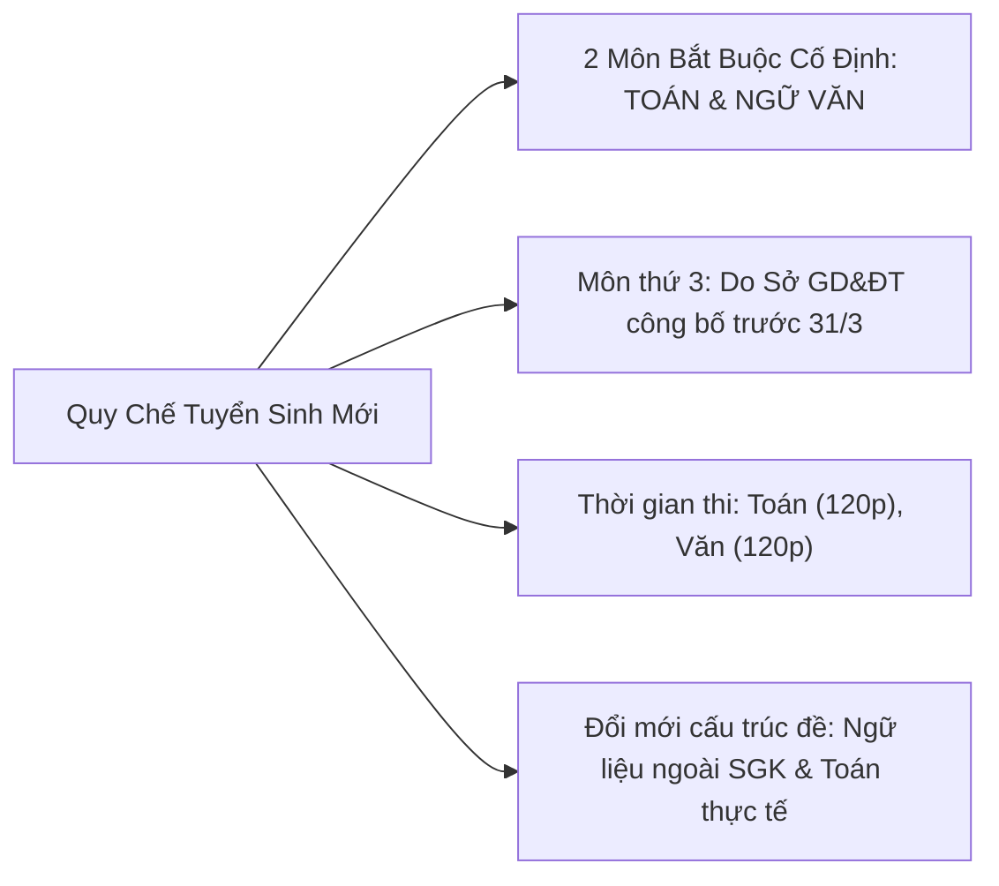
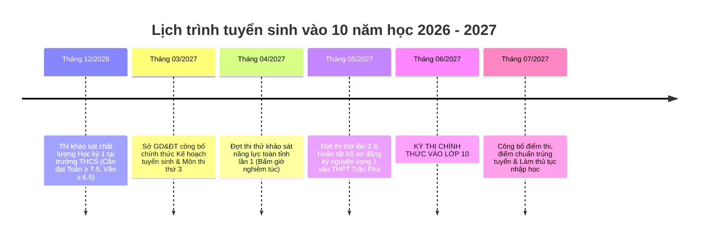

# BẢN TIN CẬP NHẬT THÔNG TIN GIÁO DỤC & TUYỂN SINH VÀO 10 NĂM HỌC 2026 - 2027
### THÔNG TIN DÀNH RIÊNG CHO KỲ THI TUYỂN SINH VÀO TRƯỜNG THPT TRẦN PHÚ (VĨNH YÊN)
### CĂN CỨ THEO DỰ THẢO QUY CHẾ MỚI CỦA BỘ GIÁO DỤC VÀ ĐÀO TẠO

---

## 1. ĐIỂM MỚI QUAN TRỌNG TRONG QUY CHẾ TUYỂN SINH VÀO 10 CỦA BỘ GD&ĐT (2026 - 2027)

Bộ Giáo dục và Đào tạo đã ban hành định hướng và dự thảo quy chế tuyển sinh THCS và THPT mới nhất áp dụng thống nhất trên toàn quốc theo Chương trình GDPT 2018 với các nội dung mang tính bước ngoặt:

### Chi tiết các điểm cốt lõi phụ huynh và học sinh cần nắm:
1. **Toán và Ngữ văn là 2 môn xuyên suốt và bắt buộc:**
   - Tất cả các tỉnh thành trên toàn quốc bắt buộc phải thi 2 môn Toán và Ngữ văn. Môn thi thứ 3 (nếu có, ví dụ Tiếng Anh hoặc môn bốc thăm) sẽ được công bố trước ngày 31/3 hàng năm.
   - Do đó, việc tập trung dồn lực bứt phá **Toán và Văn** là chiến lược tối ưu và an toàn nhất, quyết định đến 80-90% kết quả thi đỗ vào trường cấp 3 công lập top đầu.
2. **Thời gian làm bài thi:**
   - Môn Toán: 120 phút (hoặc 90 phút tùy phân bổ trắc nghiệm và tự luận của từng tỉnh).
   - Môn Ngữ văn: 120 phút (100% tự luận).
3. **Đổi mới triệt để cách ra đề thi:**
   - **Môn Ngữ văn:** Ngữ liệu phần Đọc hiểu và bài viết Nghị luận xã hội/Nghị luận văn học được lấy **hoàn toàn NGOÀI Sách giáo khoa**. Mục đích là chấm dứt triệt để nạn học vẹt, chép văn mẫu, ép học sinh phải rèn năng lực đọc - hiểu và kỹ năng lập luận thực chất.
   - **Môn Toán:** Tăng tỷ lệ các câu hỏi ứng dụng thực tiễn (tính tiền điện thoại, chiết khấu khuyến mãi siêu thị, lãi suất ngân hàng, bài toán chuyển động tàu thuyền, năng suất làm việc, thể tích hình trụ/nón/cầu trong đời sống).

---

## 2. HỒ SƠ TUYỂN SINH TRƯỜNG THPT TRẦN PHÚ (TP. VĨNH YÊN, TỈNH VĨNH PHÚC)

### Vị thế và độ cạnh tranh:
* **Địa chỉ:** Đường Nguyễn Tất Thành, Phường Định Trung, TP. Vĩnh Yên, tỉnh Vĩnh Phúc.
* **Xếp hạng:** Trường THPT công lập không chuyên top 1 của TP. Vĩnh Yên và toàn tỉnh Vĩnh Phúc (chỉ đứng sau trường THPT Chuyên Vĩnh Phúc).
* **Môi trường học tập:** Cơ sở vật chất khang trang, chất lượng đội ngũ giáo viên dẫn đầu, tỷ lệ học sinh đỗ các trường đại học top 1 (ĐH Bách Khoa, ĐH Ngoại Thương, ĐH Quốc Gia Hà Nội, ĐH Y Hà Nội) hàng năm luôn đạt trên 95%.
* **Tỷ lệ chọi:** Trung bình 1 chọi 1.8 đến 1 chọi 2.2 (hơn 900 - 1.100 thí sinh đăng ký nguyện vọng 1 tranh 450 - 500 chỉ tiêu).

---

### Thống kê Điểm chuẩn trúng tuyển qua các năm gần nhất:

| Năm học | Chỉ tiêu tuyển sinh | Điểm chuẩn NV1 | Điểm sàn khu vực Vĩnh Yên | Nhận xét độ khó |
| :---: | :---: | :---: | :---: | :--- |
| **2023 - 2024** | 450 chỉ tiêu (10 lớp) | **32.50 điểm** (hệ số 2 Toán/Văn) | 28.00 điểm | Đề thi phân hóa cao ở Toán và Văn |
| **2024 - 2025** | 495 chỉ tiêu (11 lớp) | **33.25 điểm** | 29.00 điểm | Điểm chuẩn tăng do lượng thí sinh đông |
| **2025 - 2026** | 495 chỉ tiêu (11 lớp) | **22.50 điểm** (tính hệ số 1) | 19.50 điểm | Áp dụng cấu trúc GDPT 2018 mới |
| **DỰ KIẾN 2026 - 2027** | **~ 500 chỉ tiêu** | **Từ 22.5 đến 24.5 điểm** | **~ 20.0 điểm** | **Mục tiêu an toàn: Đạt ≥ 24.5 điểm** |

> [!IMPORTANT]
> **Kịch bản điểm số an toàn tuyệt đối cho con:**
> - **Môn Toán:** Đạt từ **8.5 đến 9.0 điểm** (Lấy trọn 2.0đ trắc nghiệm + 6.5đ tự luận).
> - **Môn Ngữ văn:** Đạt từ **7.5 đến 8.0 điểm** (Lấy 3.5đ đọc hiểu + 1.75đ NLXH 200 chữ + 2.5đ NLVH).
> - **Môn thứ 3 (nếu có - Tiếng Anh):** Đạt từ **8.0 đến 8.5 điểm**.
> ➔ **Tổng điểm: 24.5 - 25.5 điểm** ➔ Chắc chắn cầm chắc tấm vé trúng tuyển vào THPT Trần Phú mà không cần lo lắng về biến động điểm chuẩn!

---

### Quy định về khu vực tuyển sinh (Dành cho học sinh Phú Thọ):
* Trường THPT Trần Phú tuyển sinh học sinh tốt nghiệp THCS trên địa bàn TP. Vĩnh Yên và các vùng lân cận thuộc tỉnh Vĩnh Phúc.
* Đối với học sinh ở Phú Thọ (khu vực TP. Việt Trì, Huyện Phù Ninh, Huyện Lâm Thao qua cầu Hạc Trì sang Vĩnh Yên): Phụ huynh cần lưu ý quy định về đăng ký hộ khẩu thường trú hoặc tạm trú, hoặc xác nhận học bạ THCS hợp lệ theo hướng dẫn tuyển sinh hàng năm của Sở GD&ĐT Vĩnh Phúc (thường công bố vào tháng 3 - tháng 4).

---

## 3. LỊCH TRÌNH VÀ CÁC MỐC THỜI GIAN QUAN TRỌNG NĂM HỌC 2026 - 2027

---

## 4. LỜI KHUYÊN DÀNH CHO PHỤ HUYNH TRONG TỪNG GIAI ĐOẠN

1. **Giai đoạn hiện tại (Tháng 10 - Tháng 12/2026):**
   - Không tạo áp lực điểm số mà tập trung kéo con vào bàn học đều đặn mỗi tối 2 tiếng.
   - Ưu tiên lấp lỗ hổng môn Văn (từ 4 lên 6.5) và rèn tính cẩn thận cho môn Toán để không bị trừ điểm ẩu ở phần trắc nghiệm.
2. **Giai đoạn sau Tết (Tháng 1 - Tháng 3/2027):**
   - Bắt đầu cho con luyện đề thi thử có bấm giờ trên website tự động tạo đề.
   - Quan sát mục "Sổ tay lỗi sai" để biết con hay bị mất điểm ở chuyên đề nào (Ví dụ: hay nhầm dấu Vi-ét hay quên điều kiện mẫu số).
3. **Giai đoạn nước rút (Tháng 4 - Tháng 6/2027):**
   - Đảm bảo dinh dưỡng và giấc ngủ (ngủ đủ 7-8 tiếng/ngày).
   - Thường xuyên khích lệ tinh thần: Tự tin bước vào phòng thi với tâm thế của một học sinh đã được trang bị đầy đủ công thức và phản xạ làm đề!
